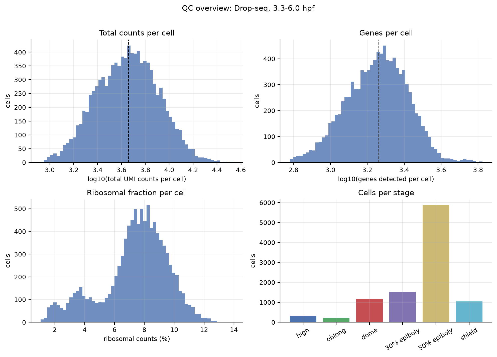
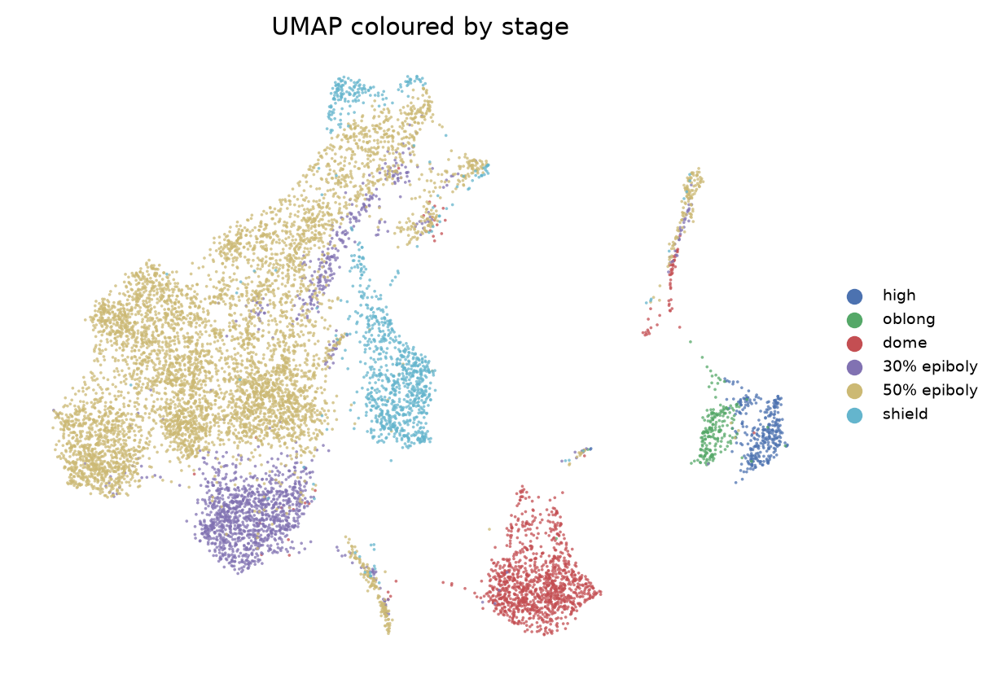
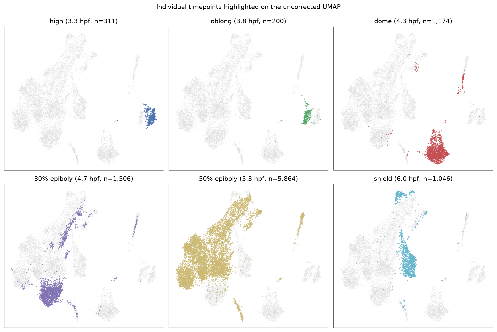

# Zebrafish early-development Boolean model

Working repository for a Boolean model of cell differentiation in zebrafish
early development (1–6 hpf).

**Current status:** the GSE106587 atlas is downloaded; the wild-type Drop-seq
cells from **3.3–6.0 hpf** have been extracted into AnnData, QC-summarised and
embedded with UMAP as a sanity check. No Boolean model has been fitted yet.

## Biological data

The source is GEO SuperSeries **GSE106587** (Farrell et al., 2018, *Science*,
PMID 29700225), specifically the Drop-seq SubSeries **GSE106474**. See
[AGENTS.md](AGENTS.md) for the full download inventory, file checksums and
coverage caveats.

| Item | Value |
|---|---|
| Assay | Drop-seq, wild type |
| Stages in subset | high, oblong, dome, 30% epiboly, 50% epiboly, shield |
| Time window | 3.3–6.0 hpf |
| Cells | **10,101** |
| Genes (raw) | 23,974 |
| Total UMI counts | 53,969,493 |
| Median counts / genes per cell | 4,541 / 1,829 |

**Coverage gap:** GSE106587 starts at high stage (3.3 hpf); it does not contain
1–3 hpf cleavage/blastula cells. An additional dataset will be needed if the
model must start at 1 hpf.

## Environment

All analysis is in a project-local virtual environment. Setup is reproducible:

```bash
bash scripts/00_setup_env.sh
```

This creates `.venv/` and installs exact versions from
`requirements.lock.txt` (top-level pins and rationale are in
`requirements.txt`). Key versions: Python 3.12.3, scanpy 1.12.4, anndata
0.13.4, numpy 2.5.4, pandas 3.0.6, scipy 1.18.1, harmonypy 2.1.0,
matplotlib 3.11.2. No API keys or external services are required after the data
download.

## Pipeline

Scripts are numbered in execution order. Run everything with:

```bash
bash scripts/run_pipeline.sh          # reuse existing stage-01/03/04 outputs
bash scripts/run_pipeline.sh --force  # recompute all stages
```

| Stage | Script | Input | Main output | Approx. runtime |
|---|---|---|---|---|
| 01 | `scripts/01_build_dropseq_subset.py` | GEO Drop-seq TSV + cell metadata | `data/processed/dropseq_3.3-6.0hpf_raw.h5ad` | ~7 min |
| 02 | `scripts/02_qc_summary.py` | stage-01 h5ad | QC tables + histograms; `..._qc.h5ad` | ~15 s |
| 03 | `scripts/03_umap_sanity.py` | stage-01 h5ad | normalised/PCA/UMAP object; uncorrected UMAP | ~2 min |
| 04 | `scripts/04_umap_harmony.py` | stage-03 h5ad | Harmony-corrected diagnostic UMAP | ~2 min |
| 05 | `scripts/05_dataset_structure.py` | GEO Drop-seq TSV (streamed) + metadata + SOFT | stage × batch × library tables/figures for the full atlas | ~4 min (first run), seconds after |
| 06 | `scripts/06_library_clustering.py` | stage-02 h5ad | per-library Leiden + UMAP, cluster QC tables, `data/processed/libraries/*.h5ad` | ~2 min |
| 07 | `scripts/07_merged_contexts.py` | stage-02 h5ad + stage-06 labels | joint UMAP/Leiden for DS5 (across time) and 50% epiboly (across batches); local-vs-joint, centroid-correlation and kNN-mapping comparisons | ~40 s |

Individual stages:

```bash
.venv/bin/python scripts/01_build_dropseq_subset.py
.venv/bin/python scripts/02_qc_summary.py
.venv/bin/python scripts/03_umap_sanity.py
.venv/bin/python scripts/04_umap_harmony.py
.venv/bin/python scripts/05_dataset_structure.py
.venv/bin/python scripts/06_library_clustering.py
.venv/bin/python scripts/07_merged_contexts.py
```

Stages 06 and 07 also accept `--force`. Stage 01 is the expensive step (reading the 1 GB compressed TSV). Stages 01, 03
and 04 accept `--force`; without it they skip if their output exists. Stage 02
always regenerates its tables/figures. Stage 01 needs roughly 8–10 GB of RAM.

### Stage details

- **01 — subset:** keeps all cells whose stage maps to 3.3, 3.8, 4.3, 4.7, 5.3
  or 6.0 hpf. Raw UMI counts are stored as a sparse CSR matrix, cells × genes.
- **02 — QC:** computes total counts, genes per cell, ribosomal fraction
  (`RPL*`/`RPS*`, 94 genes) and top-50-gene fraction. **No cells are removed.**
  The matrix contains no mitochondrial genes, so `pct_counts_mt` is not
  available.
- **03 — sanity UMAP:** applies mild filters (`min_genes=200`,
  `min_counts=500`, `min_cells=3`; currently all 10,101 cells pass), then
  library-size normalisation, log1p, 2,000 batch-aware HVGs, PCA (50 PCs),
  15-neighbour graph, UMAP and Leiden (resolution 0.5).
- **04 — diagnostic Harmony:** runs Harmony on the PCA using
  `sequencing_batch`. This is a **diagnostic, not the primary embedding**; see
  the batch caveat below.
- **05 — dataset structure:** describes the full 39,505-cell atlas (all 12
  stages) as stage → sequencing batch → library (GEO sample), with per-library
  cell counts and median UMIs/genes. The per-cell QC is cached in
  `results/tables/05_cell_qc_full_atlas.csv`; delete it to recompute. The
  human-readable overview is
  [results/05_dataset_structure.md](results/05_dataset_structure.md).
- **06 — per-library clustering:** clusters each of the 12 libraries in the
  3.3–6.0 hpf window on its own, with no batch correction. It runs HVG → PCA
  → kNN → Leiden (resolution 0.5) → UMAP. Per cluster it reports marker
  count, bootstrap Jaccard stability, silhouette, depth ratio and Scrublet
  score. The interpretation, including which libraries' clusters are
  meaningful, is in
  [results/06_library_clustering.md](results/06_library_clustering.md).
- **07 — merged contexts:** merges related libraries, with no batch
  correction, and asks where the stage-06 clusters land in the shared space.
  The two contexts are DS5 across timepoints (3.3–6.0 hpf) and 50% epiboly
  across batches/replicates. See
  [results/07_merged_contexts.md](results/07_merged_contexts.md).

## Key QC and sanity-check findings

QC overview:



The subset is already high quality: every cell has ≥838 UMI counts and ≥603
detected genes, with median 4,541 counts / 1,829 genes. Ribosomal fraction is
bimodal and rises from high/oblong (~2%) to shield (~8%). There are no
mitochondrial features in the GEO matrix.

Primary UMAP (uncorrected, coloured by stage):



Individual timepoints highlighted against all cells:



**The UMAP is strongly affected by sequencing batch.** Stage and batch are
almost completely confounded in this subset:

| Stage | DS2 | DS3 | DS4 | DS5 |
|---|---:|---:|---:|---:|
| high | 0 | 0 | 0 | 311 |
| oblong | 0 | 0 | 0 | 200 |
| dome | 0 | 0 | 0 | 1,174 |
| 30% epiboly | 0 | 0 | 0 | 1,506 |
| 50% epiboly | 1,287 | 1,430 | 3,147 | 0 |
| shield | 0 | 0 | 0 | 1,046 |

All non-50%-epiboly stages are DS5, while 50% epiboly is entirely DS2–DS4. At
the DS5 vs DS2–DS4 level, **stage and batch are perfectly confounded**: no
stage is represented in both groups. The uncorrected UMAP therefore groups
high/oblong/shield (all DS5) and separates 50% epiboly, rather than forming a
clean developmental trajectory.

Harmony reduces the batch silhouette (0.015 → −0.032) but also reduces the
stage silhouette (0.032 → 0.016) and produces disconnected islands; it
**overcorrects** because the biological variable is confounded with batch. It
should not be used for biological interpretation. The before/after diagnostic
is in `results/figures/04_umap_before_after_stage.png`.

Implication for the Boolean model: do not treat a naïvely batch-corrected
embedding as the developmental trajectory. Either model stage explicitly,
include batch as a covariate in a batch-aware framework, or analyse the
DS5 and DS2–DS4 cells with a design that acknowledges the confounding. The
published URD analysis (Farrell et al.) is a useful reference for how the
original authors handled these data.

## Output layout

```
data/processed/
  dropseq_3.3-6.0hpf_raw.h5ad          # raw counts, all genes (stage 01)
  dropseq_3.3-6.0hpf_qc.h5ad           # raw counts + QC metrics (stage 02)
  dropseq_3.3-6.0hpf_umap.h5ad         # lognorm + counts layer + PCA/UMAP/Leiden (stage 03)
  dropseq_3.3-6.0hpf_umap_harmony.h5ad # diagnostic Harmony embedding (stage 04)

results/figures/
  02_*.png/.pdf      # QC histograms, violins, scatter, gene detection
  03_*.png/.pdf      # uncorrected UMAP, PCA variance
  04_*.png/.pdf      # Harmony diagnostic UMAPs, before/after

results/tables/
  01_*.tsv           # subset dimensions, cells per stage
  02_*.csv/tsv       # per-cell QC, overall/by-stage summaries, top genes,
                     # stage × batch composition, notes
  03_*.csv/tsv       # UMAP coordinates, embedding parameters, Leiden × stage
  04_*.csv/tsv       # Harmony coordinates, silhouettes, cluster composition
```

All raw and processed data are gitignored; small tables and figures are kept.

## Reproducibility

- Download, extraction and checksums: `bash scripts/download_gse106587.sh`
- Cell metadata: `python3 scripts/build_metadata.py`
- Data integrity: `python3 scripts/validate_data.py`
  (`data/metadata/validation_report.txt` currently reports PASS)
- Random seed for PCA/neighbours/UMAP/Leiden: `0`
- Embedding parameters are recorded in `results/tables/03_umap_summary.tsv` and
  `04_harmony_summary.tsv`.

See [AGENTS.md](AGENTS.md) for the data inventory, download provenance, tool
notes and operational caveats for future agents.

## Suggested next steps

1. Decide how to handle the stage–batch confounding before any trajectory or
   Boolean inference.
2. Define Boolean states (e.g. binarised expression of marker/regulator genes)
   and candidate regulatory links.
3. Add the missing 1–3 hpf data if the model must cover the full 1–6 hpf
   interval.
4. Validate any inferred network against held-out stages and published
   zebrafish developmental annotations.
