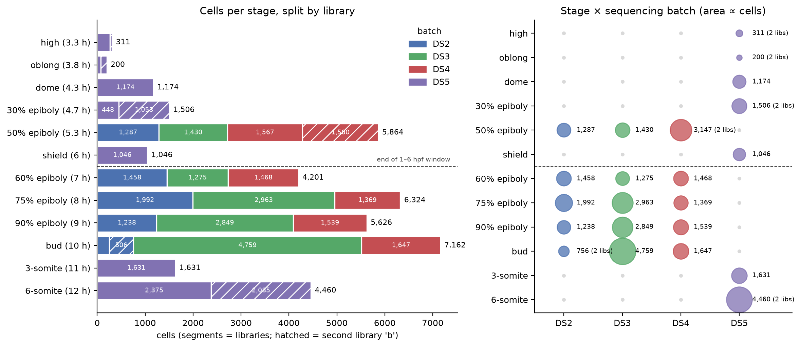
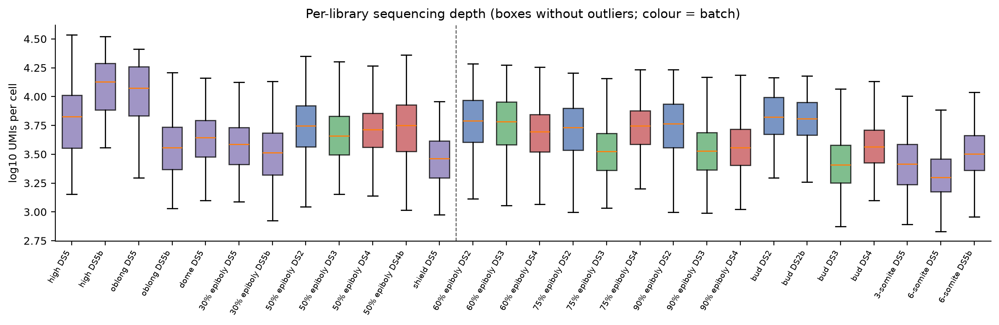

# Drop-seq atlas (GSE106474): how stages, batches and libraries fit together

Generated by `scripts/05_dataset_structure.py`. All numbers are raw GEO cells,
with no filtering. Tables are in `results/tables/05_*.tsv`.



## The hierarchy

The data has three nested levels:

```
stage (12 stages, 3.3–12 hpf)
└── sequencing batch (DS2, DS3, DS4, DS5)
    └── library (one GEO sample / GSM, 28 in total)
        └── cells (39,505 in total)
```

- **Stage**: the developmental timepoint. Each stage is one hpf value.
- **Sequencing batch** (`DS2`–`DS5`): GEO's "sequencing batch" field. This is
  the main source of technical variation.
- **Library**: one Drop-seq library, i.e. one GEO sample (GSM) and one SRA
  experiment. Most (stage, batch) pairs have exactly one library. **Six pairs
  have two libraries**, and the second one gets a `b` suffix in the cell name
  (`ZF50_WT_DS4b_…`). In the metadata this is `replicate = a/b`.

Naming gotcha: GEO's "Rep N" in the sample title numbers the libraries within a
stage *across all batches*. So "50% epiboly Rep 2" is a different batch (DS3)
from Rep 1 (DS2), while "high Rep 2" is the same batch (DS5) as Rep 1. Our
`replicate` column (`a`/`b`) only means "second library within the same stage
and batch". GEO does not say whether the `b` libraries are separate embryo
pools (biological replicates) or a second Drop-seq run of the same pool
(technical replicates). The GSM numbers for `a` vs `b` in DS4 at 50% epiboly
and in DS2 at bud follow GEO ordering; this is inferred, not stated by GEO.

## Two separate design blocks

The batches split the atlas into two blocks that **share no stage**:

| Block | Batches | Stages | hpf | Cells | Libraries |
|---|---|---|---|---:|---:|
| A | DS5 only | high, oblong, dome, 30% epiboly, shield, 3-somite, 6-somite | 3.3–4.7, 6.0, 11–12 | 10,328 | 11 |
| B | DS2 + DS3 + DS4 | 50% epiboly, 60%, 75%, 90% epiboly, bud | 5.3–10 | 29,177 | 17 |

- **Block B is a balanced design.** Each of its five stages was sequenced in
  all three batches (DS2, DS3, DS4). Within block B, stage and batch effects
  *can* be separated.
- **Block A is a single batch.** Stage differences inside DS5 are not
  confounded with batch, but there is nothing to estimate a DS5 batch effect
  from.
- **No stage appears in both blocks.** The DS5 vs DS2–DS4 difference is
  therefore confounded with stage everywhere in the atlas, not only in our
  3.3–6.0 hpf subset. Adding more stages from GSE106474 does not fix this.
  Shield (6.0 h, DS5) is sandwiched in time between 50% epiboly (5.3 h) and
  60% epiboly (7.0 h), which are both block B. This makes the
  50% epiboly → shield → 60% epiboly step the place where a batch jump shows
  up as a fake developmental jump.

## Cohorts in the 1–6 hpf window

Within the window there are 6 stages, 12 libraries and 10,101 cells:

| Stage | hpf | Batch | Library | Cells | Median UMIs | Median genes | Replication |
|---|---:|---|---|---:|---:|---:|---|
| high | 3.3 | DS5 | a | 263 | 6,731 | 3,009 | 2 libraries, same batch |
| high | 3.3 | DS5 | b | **48** | 13,385 | 4,566 | |
| oblong | 3.8 | DS5 | a | **72** | 11,866 | 4,171 | 2 libraries, same batch |
| oblong | 3.8 | DS5 | b | 128 | 3,603 | 2,048 | |
| dome | 4.3 | DS5 | a | 1,174 | 4,398 | 1,931 | **none** (1 library) |
| 30% epiboly | 4.7 | DS5 | a | 448 | 3,858 | 1,717 | 2 libraries, same batch |
| 30% epiboly | 4.7 | DS5 | b | 1,058 | 3,260 | 1,564 | |
| 50% epiboly | 5.3 | DS2 | a | 1,287 | 5,600 | 2,106 | 3 batches, 4 libraries |
| 50% epiboly | 5.3 | DS3 | a | 1,430 | 4,563 | 1,731 | |
| 50% epiboly | 5.3 | DS4 | a | 1,567 | 5,179 | 1,988 | |
| 50% epiboly | 5.3 | DS4 | b | 1,580 | 5,631 | 1,963 | |
| shield | 6.0 | DS5 | a | 1,046 | 2,904 | 1,291 | **none** (1 library) |

What this means in practice:

- **Only 50% epiboly is replicated across batches.** It holds 58% of all
  cells in the window. A model fitted naively on cell counts will mostly
  describe 50% epiboly.
- **Dome and shield come from a single library each.** There is no
  replicate, so library effects and biology cannot be told apart at these
  stages.
- **High and oblong are tiny.** Together they have 511 cells, and three of
  their four libraries have fewer than 150 cells (48, 72 and 128). Anything
  cell-type-specific at these stages rests on a few dozen cells.
- **Sequencing depth varies a lot between libraries of the same stage and
  batch.** At oblong, library `a` has a median of 11,866 UMIs/cell and library
  `b` has 3,603 (3.3×). At high, `b` has 2× the depth of `a`. So within-batch
  libraries are not interchangeable. The library, not just the batch, is a
  technical unit worth tracking.
- Depth drops with developmental time (high/oblong around 7–13k → shield
  around 2.9k UMIs/cell). Part of this is probably biological: early
  blastomeres are larger and fewer. But it is also confounded with library,
  so library-size normalisation and binarisation thresholds should be checked
  per library.



## Later stages (outside the window, for context)

| Stage | hpf | DS2 | DS3 | DS4 | DS5 | Total |
|---|---:|---:|---:|---:|---:|---:|
| 60% epiboly | 7.0 | 1,458 | 1,275 | 1,468 | – | 4,201 |
| 75% epiboly | 8.0 | 1,992 | 2,963 | 1,369 | – | 6,324 |
| 90% epiboly | 9.0 | 1,238 | 2,849 | 1,539 | – | 5,626 |
| bud | 10.0 | 756 (a 250 + b 506) | 4,759 | 1,647 | – | 7,162 |
| 3-somite | 11.0 | – | – | – | 1,631 | 1,631 |
| 6-somite | 12.0 | – | – | – | 4,460 (a 2,375 + b 2,085) | 4,460 |

DS3 libraries in block B tend to be larger but shallower (for example bud DS3:
4,759 cells at a median of 2,556 UMIs). This is a classic batch signature, and
block B lets us measure it.

## Suggested cohort unit for downstream work

Use **library** (`stage × sequencing_batch × replicate`, equivalently
`geo_sample`) as the basic cohort. It is the finest technical grouping
available. Aggregate to (stage, batch) or stage only where the analysis allows
it. In particular:

1. Use block B (50% epiboly → bud) to estimate how large DS2/DS3/DS4 batch
   effects are relative to stage effects. That gives a rough idea of how much
   of the DS5 vs DS2–DS4 jump is likely to be technical.
2. Use the within-DS5 `a`/`b` pairs (high, oblong, 30% epiboly) to estimate
   library-to-library variation within one batch.
3. Treat dome and shield as unreplicated. Treat high and oblong as
   low-confidence because they have few cells.
4. Stage-balance by downsampling or weighting before building Boolean states,
   so that 50% epiboly does not dominate.
