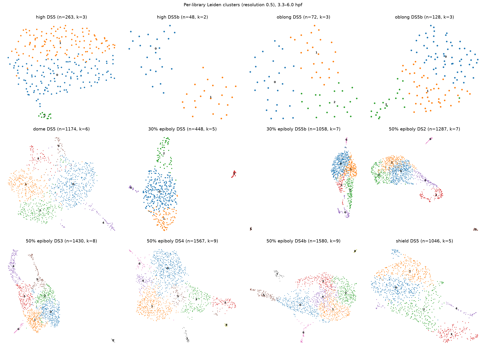
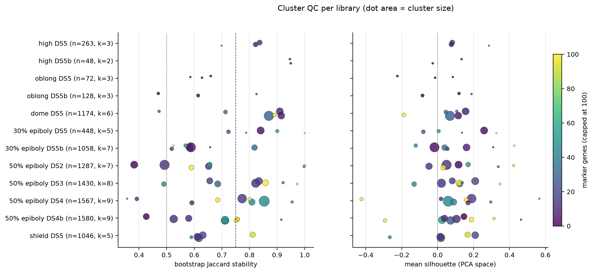

# Per-library Leiden clustering (3.3–6.0 hpf, 12 libraries)

Generated by `scripts/06_library_clustering.py`. Each Drop-seq library (one
stage × batch × replicate, see [05_dataset_structure.md](05_dataset_structure.md))
is normalised, embedded and clustered on its own. Because of this, **no batch
correction is involved**. Cluster IDs are local to each library: cluster 3 in
one library has nothing to do with cluster 3 in another.

Per-library panels show Leiden, depth, ribosomal fraction, Scrublet score and
cluster stability. They are in `figures/06_libraries/06_umap_<library>.png`.

## Defaults

| Step | Setting |
|---|---|
| Genes | detected in ≥3 cells *of that library* |
| Normalisation | CP10k + log1p |
| Features | 2,000 HVGs (`seurat` flavour), scaled (max 10) |
| PCA | 30 components, 20 used for the graph |
| Graph | 15 neighbours. Tiny libraries use n/10 (min 5): high b = 5, oblong a = 7, oblong b = 12 |
| Clustering | Leiden (leidenalg), resolution **0.5**. Cluster counts at 0.2 and 1.0 are also recorded |
| UMAP | `min_dist = 0.3` |

No cells were removed. All cells already pass the mild stage-03 filters.

## Cluster QC metrics

All metrics are in `tables/06_cluster_qc.tsv`, one row per cluster:

| Metric | What it tells you | Rule of thumb |
|---|---|---|
| `n_markers` | genes with padj < 0.05, log2FC > 1, detected in ≥25% of the cluster (Wilcoxon, cluster vs rest) | 0–5: no transcriptional identity |
| `stability_jaccard` | mean best-match Jaccard after re-clustering 20 random 80% subsamples | >0.75 stable; 0.6–0.75 weak; <0.5 dissolves |
| `silhouette` | separation in the PCA space used for the graph | ≈0: carved out of a continuum |
| `log2_depth_ratio` | cluster median UMIs vs library median | ≲ −0.6 with no markers: low-quality / depth-driven |
| `doublet_score` | mean Scrublet score | none stood out (all 0.03–0.11) |

Two library-level metrics are in `tables/06_library_clustering_summary.tsv`:
- `seed_ari`: agreement of the partition across 5 Leiden seeds.
- the fraction of cells that fall in stable clusters.

Top markers per cluster (up to 20, with statistics) are in
`tables/06_cluster_markers.tsv`. Cell-level assignments and UMAP coordinates
are in `tables/06_cell_clusters.csv`.

## What the clusters are

Marker genes show the same small set of populations again and again. They
are recognisable zebrafish gastrula populations, plus two technical-looking
groups:

| Population | Typical markers | Found in (library: cluster) |
|---|---|---|
| **EVL** (enveloping layer) | KRT4, KRT8, KRT18, CLDNE, LYE, STARD14 | high a:2 (13 cells), oblong b:2 (20), dome:4, 30% a:3, 30% b:5, 50% DS2:5, DS3:7, DS4:6, DS4b:6 |
| **Ventrolateral margin / mesoderm** | TA, TBX16, WNT11, EVE1, CDX4, HES6, VED | dome:3, 30% a:2, 30% b:2, 50% DS2:4, DS3:3, DS4:2, DS4b:0, shield:2 |
| **Endoderm / mesendoderm** | MIXL1, SNAI1A, FOXA, LHX1A, CTH1, FSCN1A | 30% b:4, 50% DS2:3, DS3:4, DS4:3, DS4b:5, shield:3 |
| **Dorsal organizer** | CHD, NOTO, FOXD3, ADMP, GSC | dome:5, 30% b:3, 50% DS2:2, DS3:5, DS4:5 (+ prechordal GSC/FZD8B/RIPPLY1 as 8), DS4b:3 and 7, shield:4 |
| **Blastoderm / ectoderm** (continuum) | SOX3, SOX19A, SOX2, ID1, CXCR4B, NANOG, HER3, ZIC3 | the large clusters of every library from 30% epiboly on |
| **p53-response ("apoptotic-like")** | MDM2, TP53, SESN3, CDKN1A, PHLDA3, BCL2L14 | 30% a:4, 30% b:6, 50% DS2:6, DS3:6, DS4:7, DS4b:8 |
| *Low-quality* | no markers, about half the library's depth | 50% DS2:1 (−0.62 log2), 50% DS4b:4 (−1.01 log2) |
| *Heat-shock / stress* | HSP70.3, HSPE1, SERPINH1B | 50% DS4:4 |

Notes:
- The EVL and p53 clusters are the most discrete populations in the data.
  They have hundreds of markers (up to 538), Jaccard ≥ 0.9 in most libraries,
  and appear in every library large enough to resolve them.
- The p53 cluster matches the "apoptotic-like" population reported by
  Farrell et al. It is probably partly a dissociation/stress response, so
  treat it as a candidate exclusion rather than a lineage.
- At shield, EVL cells (about 14) are not separate at resolution 0.5. They
  sit inside cluster 4 (dorsal organizer) because they are a small fraction
  of that library.
- A weak split recurs in the early DS5 libraries: high 0/1, dome 1/2 and
  30% a 0/1. One side carries PFN1, SI:CH1073-190K2.1 and GPD1B; the other
  carries MCM6, FOSAB and GADD45GA in dome, or PTENA and CHAC1 in high. It is
  stable under bootstrap but has few markers and silhouette ≈ 0.1. It looks
  like a continuous axis (possibly cell cycle or maternal-to-zygotic
  transition), not discrete types. In dome it also follows ribosomal
  fraction: median 4.6% in cluster 1 vs 3.6% in cluster 0. Scoring
  cell-cycle phase would test this.

## Where the clustering is meaningful

**Not meaningful: high b (48), oblong a (72), oblong b (128), and mostly high a (263).**
- Oblong a has **zero** markers in all three clusters. Oblong b has 0–1
  markers except an EVL group of 20 cells.
- High b looks perfectly stable (Jaccard 0.95). That is an artefact: a
  48-cell graph splits in two the same way every time, but the halves differ
  by only 4–5 genes and have silhouette ≈ 0.
- At these stages the only real structure is a small EVL group in high a
  (13 cells, 21 markers) and oblong b. That fits the biology: before and
  around the mid-blastula transition, deep cells are not yet transcriptionally
  distinct. It also means that **stability alone is not enough for small
  libraries**. Always read it together with `n_markers` and silhouette.

**Meaningful, close to the right resolution: dome (1,174), 30% a (448).**
- Most clusters are stable (median Jaccard 0.88 and 0.84; seed ARI ≈ 0.82)
  and map to known populations: EVL, margin, dorsal organizer.
- The dorsal organizer cluster in dome (43 cells, Jaccard 0.47) is real
  biology, but too small to be called reliably.

**Meaningful but somewhat over-clustered: 30% b, all four 50% epiboly libraries, shield.**
- The small discrete populations are robust: EVL, p53, margin, endoderm, and
  the organizer in most libraries.
- The large ectoderm/blastoderm mass is cut into 2–4 pieces that change with
  seed and subsample. Examples:
  - 30% b cluster 0/1: Jaccard 0.59/0.58, 2–8 markers
  - 50% DS2 cluster 0: Jaccard 0.49
  - 50% DS4b cluster 1: Jaccard 0.53
  - shield clusters 0–2: Jaccard 0.61–0.63
- Seed ARI is lowest exactly in these libraries: 30% b 0.45, 50% DS2 0.45,
  shield 0.57. Those splits are boundaries drawn through a continuum (likely
  the animal–vegetal and dorsal–ventral axes), not cell types.
- The 50% epiboly organizer is also split into sub-pieces with poor
  stability (DS4 clusters 5 and 8: 0.39 and 0.36).
- Two clusters look technical: 50% DS2:1 and DS4b:4 have no markers and half
  the usual depth. 50% DS4:4 is a heat-shock group.

In short, use the clusters with Jaccard ≥ 0.75 and at least ~20 markers at
face value. Treat the big ectoderm clusters as one continuum. Treat
zero-marker, low-depth clusters as quality artefacts. Treat high and oblong
as "EVL + one undifferentiated population".

## Implications for linking clusters across libraries (next step)

- The recurring populations (EVL, margin, endoderm, organizer, p53) have
  strong, shared markers. Matching them across libraries by marker overlap
  or centroid correlation should be easy, including across the DS5 vs
  DS2–DS4 boundary. That gives a batch-independent anchor between blocks.
- The ectoderm sub-clusters should probably be merged before matching. An
  alternative is to match at resolution 0.2 (cluster counts for 0.2/1.0 are
  in the summary table) or to describe ectoderm with continuous scores.
- Low-quality, heat-shock and p53 clusters should be flagged, and probably
  excluded before Boolean state definition.
