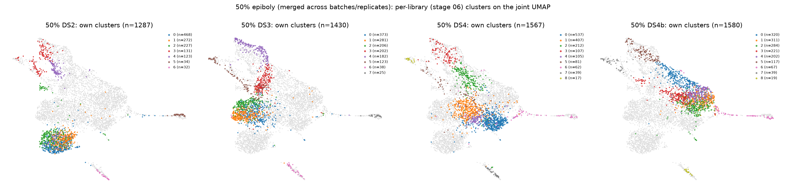
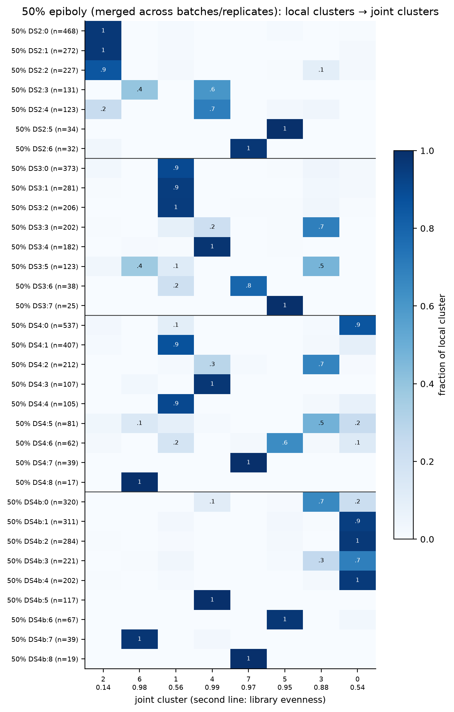
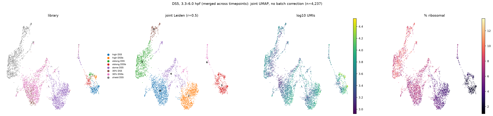
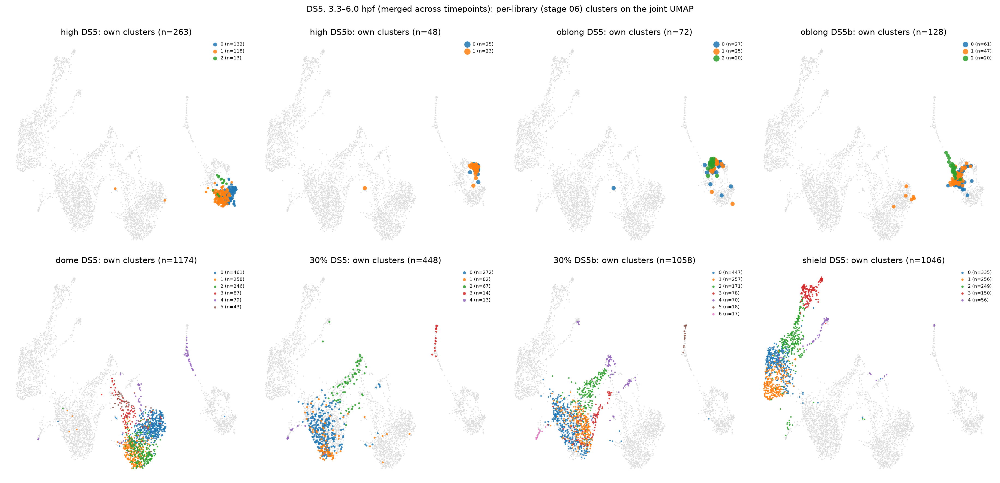
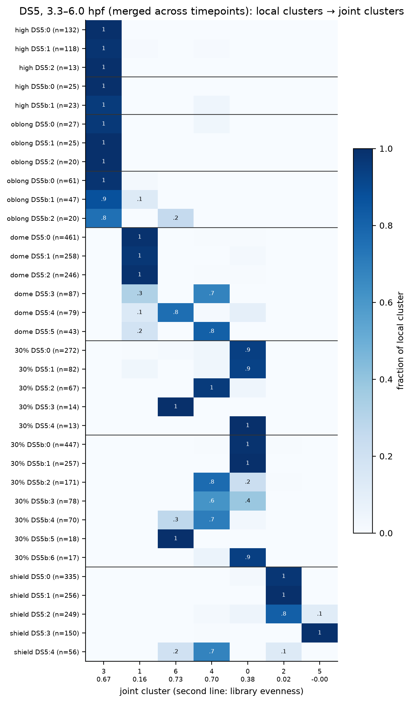

# Merging related libraries: how per-library clusters behave in a shared space

Generated by `scripts/07_merged_contexts.py`. This builds on the per-library
("local") clusters of [06_library_clustering.md](06_library_clustering.md).
Local cluster names are `<library>:<cluster>`, e.g. `30% DS5b:5`.

There are two merged contexts. Neither uses **any batch correction**, so
whatever separates in the joint space is real signal: biology, batch or
library.

| Context | Libraries | Cells | Merges across |
|---|---|---:|---|
| **ds5** | high a/b, oblong a/b, dome, 30% a/b, shield (all DS5) | 4,237 | timepoints (plus within-batch replicates) |
| **50pct** | 50% epiboly DS2, DS3, DS4, DS4b | 5,864 | batches and replicates |

Each context is processed from raw counts:
1. HVGs selected per library and combined (`batch_key="library"`).
2. PCA (50 components; 30 used for the graph), 15-NN, UMAP.
3. Joint Leiden at resolution 0.5.

## Comparisons computed

| Output | Question it answers |
|---|---|
| `*_local_clusters_on_joint` (figure) | Where does each library's own partition land in the shared UMAP? |
| `*_local_vs_joint` (figure + `_counts.tsv`) | Does a local cluster stay together, split, or merge with others in the joint clustering? |
| `*_joint_composition` (figure + tsv) | Is a joint cluster shared by all libraries or specific to one? **Library evenness** is the size-corrected entropy: 1 = every library contributes proportionally to its size, 0 = one library only |
| `*_library_agreement.tsv` | ARI/AMI between local and joint labels, per library |
| `*_cluster_similarity` (figure + two tsv) | Pearson correlation of local-cluster mean expression on the joint HVGs. **Globally centred** subtracts each gene's mean over all clusters. **Library-centred** first subtracts each library's mean profile. That removes whole-library offsets (batch, depth, *and* stage), leaving "how this cluster differs from the rest of its own library" |
| `*_knn_mapping` (figure + tsv), `*_best_matches.tsv` | For cells of local cluster A, the fraction of their 15 nearest cells *from library L2* that sit in each L2 cluster (joint PCA). Best matches, and whether they are **mutual** |

## (b) 50% epiboly: across batches and replicates

**The discrete populations merge cleanly across all four libraries.** Five
joint clusters are shared, with library evenness 0.88–0.99:

| Joint | Cells | Local clusters it collects | Population (stage 06) |
|---|---:|---|---|
| 5 | 200 | DS2:5, DS3:7, DS4:6, DS4b:6 | EVL |
| 7 | 127 | DS2:6, DS3:6, DS4:7, DS4b:8 | p53 response |
| 4 | 707 | DS2:3/4, DS3:4, DS4:3, DS4b:5 | endoderm / mesendoderm |
| 6 | 171 | DS4:8, DS4b:7, parts of DS2:3, DS3:5 | dorsal organizer / prechordal |
| 3 | 732 | DS3:3, DS4:2, DS4b:0, parts of DS3:5, DS4:5 | margin / organizer |

The kNN mapping agrees. Every one of these populations has a mutual best
match in every other library. Most matches reach 0.6–0.98 of neighbours.
Examples:
- p53: DS3:6 ↔ DS4b:8 = 0.97
- EVL: DS2:5 ↔ DS3:7 = 0.98
- endoderm: DS3:4 ↔ DS4:3 = 0.92

The weakest links involve DS4b:
- EVL DS4b:6 ↔ DS2:5 / DS3:7: 0.41–0.42
- margin DS4b:0 ↔ DS2:4: 0.48

These are still mutual, but part of those cells' neighbourhoods falls in
the adjacent bulk cluster. The library-centred correlation matrix shows the
same groups as clean blocks of 4.

**The large ectoderm/blastoderm mass is separated by library.** It falls into
three joint clusters with low evenness:
- joint 2: 96% DS2 (DS2:0/1/2)
- joint 1: DS3 + DS4 (DS3:0/1/2, DS4:1/4)
- joint 0: DS4b + DS4 (DS4b:1–4, DS4:0)

So:
- **DS2 is the most shifted batch.** Its bulk forms its own island. That
  island also has lower ribosomal fraction (`07_50pct_umap_overview.png`).
- **Same-batch replicates are not interchangeable either.** DS4's bulk is
  split between the DS3-like cluster and the DS4b-like cluster.
- Bulk-to-bulk kNN matches are weak (0.38–0.57) even when mutual. The local
  sub-divisions of the ectoderm, which stage 06 already flagged as unstable,
  do not correspond one-to-one across libraries.
- After library-centring, the bulk clusters do correlate strongly with each
  other. Their *relative* profile is shared, and the separation comes from a
  library-wide offset. That is the pattern a batch-correction method should
  be able to remove for this population.

Per-library ARI between local and joint labels is 0.22–0.57. It is highest
for DS4 (0.57), which sits in the middle of the batch spread.

## (a) DS5: across timepoints within one batch

**The joint space is organised by developmental time first:**
- **High + oblong** (all four libraries) form one island, joint cluster 3.
  The two stages and their a/b replicates intermix completely. Every local
  cluster of these libraries lands in joint 3, so per-library ARI is ≈ 0.
  This confirms stage 06: no internal structure, and high and oblong are
  not transcriptionally separable here. The only exception is the oblong b
  EVL group, which partly joins the EVL cluster.
- **Dome** is mostly its own joint cluster (joint 1, 92% dome).
- **30% epiboly a and b** mix with each other (joint 0). Within-batch
  replicates co-embed well here, unlike DS4/DS4b at 50%.
- **Shield** is its own region (joints 2 and 5, ≥99% shield).

**Two populations bridge timepoints:**
- **EVL** (joint 6, evenness 0.73): dome:4, 30%:3, 30% b:5, part of shield:4
  and oblong b:2. This is the one population whose identity clearly survives
  across stages.
- **Margin / mesendoderm / organizer** (joint 4, evenness 0.70): dome:3,
  dome:5, 30%:2, 30% b:2/3/4 and most of shield:4. Shield's lateral
  mesoderm-like cluster (shield:3) is not included; it forms joint 5 on its
  own. Shield is a single library, so we cannot tell whether that is
  development (maturing mesoderm) or a library effect.

In the library-centred correlation, the EVL clusters of high, oblong b,
dome, 30% a/b and shield form a tight block. The margin clusters of dome,
30% a/b and shield form a second block. In the globally centred version,
everything at high/oblong correlates with everything else at high/oblong.
That is the time effect dominating.

### Caveat: kNN mapping across timepoints

kNN always finds *some* neighbours in the target library. When the target
is a different stage, most source cells are far from all target cells, and
the "match" is just whichever target cluster lies closest in the joint
space. In the DS5 matrix this shows up as **hub columns**: high:1, high b:1,
oblong b:1, dome:0 and 30% b:0 absorb most cells from every other stage.
Many of the 35 "mutual" pairs in `07_ds5_best_matches.tsv` are hub-to-hub
pairs of this kind (e.g. dome:0 ↔ high b:1 = 0.95) and are **not**
identity matches.

Across DS5, the kNN mapping is meaningful only:
- between the same-stage replicates (30% a ↔ b: bulk 0.84, EVL 0.93, p53
  0.73, margin 0.54);
- for the distinctive populations (EVL maps into the other libraries' EVL
  cluster with 0.8–1.0).

For cross-stage matching, the library-centred centroid correlation is the
more trustworthy measure. A distance-aware variant (mutual nearest
neighbours, or a distance cut-off) would fix the kNN version.

## Summary

| | Discrete populations (EVL, p53, endoderm, margin, organizer) | Bulk ectoderm / blastoderm |
|---|---|---|
| **Across batches (50%)** | merge cleanly; strong mutual matches | separated by library, DS2 most; same relative profile once library offset is removed |
| **Across replicates, same batch** | merge | merge at 30% (DS5 a/b); partly separate at 50% (DS4 a/b) |
| **Across timepoints (DS5)** | EVL and margin bridge stages | organised by time; high + oblong indistinguishable |

Implications for the next iteration (connecting clusters across libraries):
1. The discrete populations can be linked across all libraries already, by
   library-centred correlation or mutual kNN within a stage. They are the
   natural anchors across the DS5 vs DS2–DS4 boundary as well.
2. The bulk ectoderm needs either batch correction restricted to the 50%
   libraries (where the design allows it) or a continuous description
   instead of discrete sub-clusters.
3. For cross-timepoint links, use a distance-aware matching. Note that
   "closest cluster at the previous stage" is not the same as "same cell
   type".
