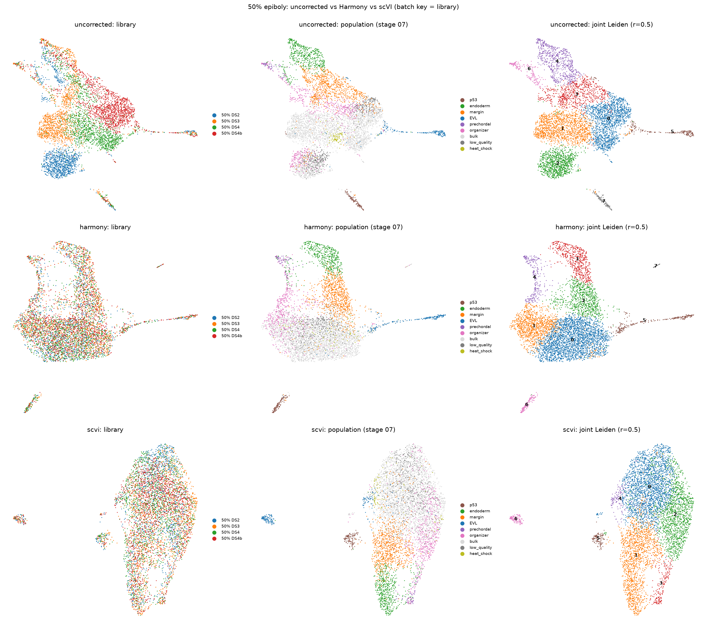
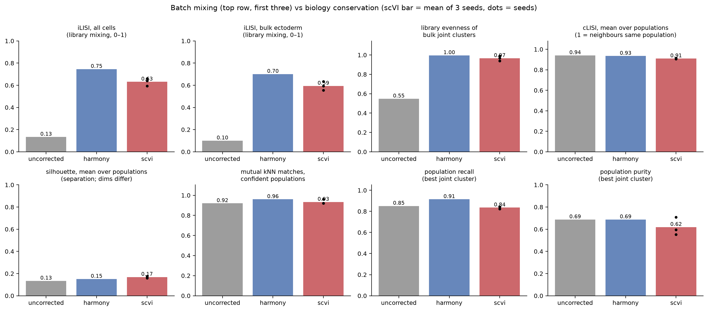
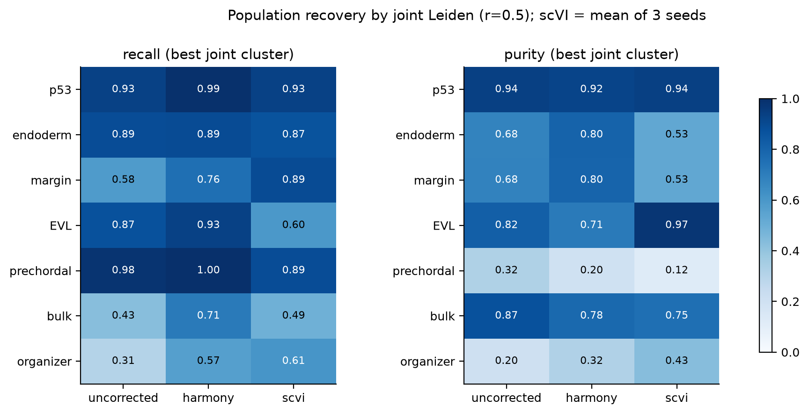

# Light batch correction of the 50% epiboly libraries: Harmony vs scVI

Generated by `scripts/08_batch_correction_50pct.py`. This starts from the
stage-07 merged 50% epiboly object (5,864 cells; DS2, DS3, DS4, DS4b). See
[07_merged_contexts.md](07_merged_contexts.md).

50% epiboly is the one stage sequenced in several batches. Batch and stage
are therefore **not** confounded, and a correction is well-posed here. That
is unlike the stage-04 Harmony run across DS5 vs DS2–DS4. The batch key is
the **library**, because DS4 and DS4b differ even though they share a
sequencing batch.

| Method | Input | Settings |
|---|---|---|
| uncorrected | stage-07 PCA | 30 PCs |
| Harmony | same 30 PCs | harmonypy 2.1.0, default theta, 20 iterations |
| scVI | raw counts, 2,000 `seurat_v3` HVGs (per-library) | scvi-tools 1.5.1, 10 latent dims, 1 hidden layer, NB likelihood, early stopping (208–228 epochs), CPU; **3 seeds** |

Every embedding gets a 15-NN graph, UMAP and Leiden at resolution 0.5. scVI
figures use seed 0. Metrics are reported for all three seeds.

## How it was scored

The scoring uses the cross-library populations from stage 07. Each
stage-06 local cluster is assigned to one population
(`tables/08_50pct_population_labels.tsv`).

- **Confident populations**, scored for biology conservation: p53,
  endoderm, margin, EVL and prechordal. The bulk ectoderm is scored as its
  own class.
- **Reported but not scored:** organizer, which was not a clean population
  before correction.
- **Ignored:** low-quality and heat-shock clusters.

| Metric | Measures | Good |
|---|---|---|
| iLISI (all / bulk) | how many libraries are in each cell's 30-NN, rescaled 0–1 | high |
| bulk cluster evenness | size-corrected library evenness of joint clusters that are mostly bulk | high |
| cLISI | how pure each cell's 30-NN is in population labels, averaged per population | high |
| silhouette | separation of populations; **not strictly comparable** (30 vs 10 dims) | high |
| mutual kNN matches | of the 25 cross-library pairs of confident local clusters, how many are mutual best matches (stage-07 method, in each embedding) | high |
| recall / purity | for each population: share of its cells in its best joint cluster / share of that cluster made of the population; **depends on Leiden resolution** | high |

| | uncorrected | Harmony | scVI (3 seeds) |
|---|---:|---:|---:|
| iLISI, all cells | 0.13 | **0.75** | 0.59–0.66 |
| iLISI, bulk | 0.10 | **0.70** | 0.55–0.63 |
| bulk cluster evenness | 0.55 | **1.00** | 0.94–0.99 |
| cLISI (populations) | **0.94** | 0.93 | 0.91 |
| silhouette (populations) | 0.13 | 0.15 | **0.16–0.18** |
| mutual matches (25 pairs) | 23 | **24** | 23–24 |
| mean recall / purity (confident) | 0.85 / 0.69 | **0.91 / 0.69** | 0.82–0.84 / 0.55–0.71 |

## What changed

**Both methods remove the library separation of the bulk ectoderm.** Before
correction, the bulk split into a DS2 island, a DS3+DS4 cluster and a
DS4b+DS4 cluster. After either correction, every joint cluster draws evenly
from all four libraries (evenness ≥0.93 for every joint cluster; one scVI
seed has a single cluster at 0.86;
`08_50pct_joint_composition.png`). Harmony mixes a little more than scVI.

**Neither method damages the discrete populations.**
- cLISI barely moves (0.94 → 0.93 / 0.91).
- p53, endoderm and margin keep all of their mutual cross-library matches.
- The population UMAP panels show the same groups in the same relative
  arrangement.
- Margin, which was split by library before, is now recovered as one
  cluster: recall 0.58 → 0.76 (Harmony) / 0.89 (scVI).

**The one persistent mismatch is not a batch effect.** EVL DS4:6 does not
mutually match DS2:5 or DS3:7 in *any* embedding (about 0.26–0.30 in one
direction, 1.0 in the other). The reason is the DS4:6 cluster itself:
- Only 68% of its cells express EVL markers. Its median EVL score is 1.5,
  vs 4.5–4.7 for DS2:5 and DS3:7 (genes KRT4/8/18/5, CLDNE, LYE, STARD14).
- It is a local cluster that absorbed non-EVL cells. That is a stage-06
  clustering issue, which correction can't and shouldn't fix.

**The two methods differ in character:**
- **Harmony** keeps the uncorrected topology and slides the libraries onto
  each other.
  - EVL stays attached to the bulk by a bridge (EVL silhouette −0.13). Its
    joint cluster recalls 93% of EVL-labelled cells but also takes in 54
    bulk cells.
  - It is deterministic and runs in seconds.
- **scVI** pulls the distinctive populations out into islands: EVL, p53 and
  the organizer-like group.
  - Its EVL cluster is very tight: 97% pure, median EVL score 4.6. It
    leaves out 76 weakly expressing cells (median 1.3), all from DS4:6 and
    DS4b:6. That looks *more* correct than Harmony, not less. The lower EVL
    "recall" (0.60) is these cells being left out.
  - Its 10-dim space is coarser at Leiden r=0.5. Margin and endoderm, which
    form a continuum in every embedding, merge into one joint cluster in 2
    of 3 seeds (endoderm purity 0.32/0.33/0.93).
  - Recall/purity vary noticeably between seeds; bulk recall ranges
    0.35–0.61.

**The organizer becomes more coherent but is still not a clean
population.** Recall rises from 0.31 to 0.57 (Harmony) / 0.61 (scVI), but
purity stays at 0.32–0.43, and only 1–2 of its 6 cross-library pairs are
mutual. Part of its earlier fragmentation was batch. The rest reflects it
grading into the margin and bulk.

## Verdict

- **A light correction clearly helps for 50% epiboly.** It turns the
  library-split bulk into one population without measurable loss of the
  discrete populations.
- **Harmony is sufficient as the default 50% epiboly embedding.** It mixes
  best, preserves the most local structure, is deterministic and adds no
  runtime cost.
- **scVI is a useful second view.** It separates distinctive populations
  more sharply and is stricter about which cells belong to them. Its
  seed-to-seed variability means a single scVI clustering should not be
  taken at face value.
- **Use either only within 50% epiboly.** Applying a correction across the
  DS5 vs DS2–DS4 boundary would remove stage along with batch (stage 04).
- **Keep raw counts for anything quantitative**, such as Boolean
  binarisation. The corrected spaces are for neighbourhoods, embedding and
  clustering.

Outputs:
- `tables/08_50pct_metrics.tsv` (one row per method/seed)
- `08_50pct_population_recovery.tsv`
- `08_50pct_population_matches.tsv` (every within-population pair, both
  directions, mutual flag)
- `08_50pct_joint_composition.tsv`
- `data/processed/08_50pct_corrected.h5ad` (`obsm`: `X_uncorrected`,
  `X_harmony`, `X_scvi_s{0,1,2}`, UMAPs; `obs`: `joint_*` labels,
  `population`)
