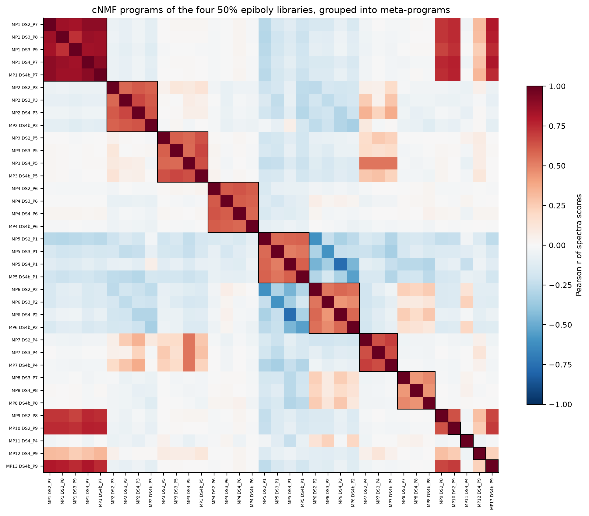
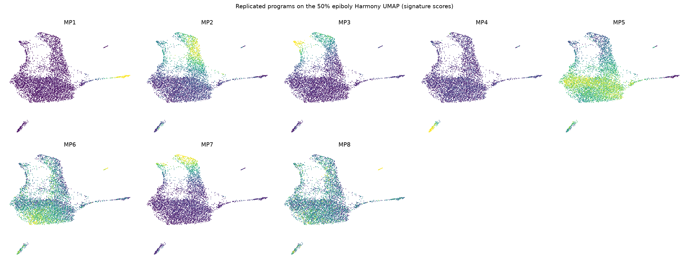
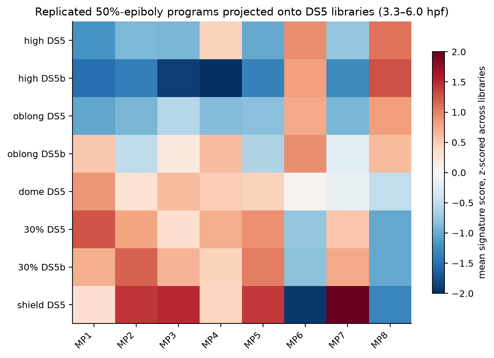

# Replicated gene programs at 50% epiboly, with database-backed interpretation

Generated by `scripts/09_gene_programs_cnmf.py` (factorisation) and
`scripts/10_program_annotation.py` (replication, annotation, projection).
References are downloaded by `scripts/download_references.sh`. Retrieval
dates and SHA-256 checksums are in `data/reference/MANIFEST.tsv`
(retrieved 2026-10-24).

> **Update (stage 11, [11_program_k_scan.md](11_program_k_scan.md)):**
> scanning K = 5–20 shows the replicated set saturates at **10 programs**
> (K ≥ 13). The two programs added beyond this K = 9 analysis are:
> - proliferation: MP11 below, which is replicated at K ≥ 13, not
>   DS4-specific;
> - a NOTO/ADMP/CHD dorsal-organizer program that splits from MP3.
>
> PGCs (MP8) are replicated in DS3/DS4/DS4b at every K from 8 to 20. The
> sections below are kept as the K = 9 analysis, with corrections marked.

## Approach

The goal is to identify expression programs without relying on any single
clustering, and to interpret them from curated databases rather than from
remembered marker genes.

1. **Programs per library.** Consensus NMF (cNMF, Kotliar et al. 2019) runs
   on raw counts of each 50% epiboly library separately (DS2, DS3, DS4,
   DS4b). It uses 2,000 HVGs and 100 NMF runs per K, for K = 5–15. There is
   **no batch correction**: each library is an independent sample.
2. **One common K.** K = 9 is the K ≥ 7 that maximises the *worst*
   library's consensus stability (all four ≥ 0.80;
   `figures/09_k_selection.png`). The floor of 7 is the number of
   populations stage 07 already resolved. Robustness is checked at K = 7
   and K = 12.
3. **Replication.** Programs from different libraries are linked only when
   both conditions hold (`tables/10_program_pairs.tsv`):
   - they are mutual best matches by Pearson r of their gene spectra
     (12,321 genes shared by all libraries);
   - their top-50 genes overlap significantly (hypergeometric,
     BH q < 0.001).

   Linked programs form a meta-program (MP). An MP is **replicated** if it
   spans ≥ 3 of the 4 libraries.
4. **Annotation from databases only.** Each MP's 50-gene consensus
   signature is tested for enrichment against two sources.

   | Source | Restrictions | Ontology propagation | Universe |
   |---|---|---|---|
   | **ZFIN curated wild-type expression** | mRNA in situ only; stage range overlaps 4.66–6.0 hpf (30% epiboly → shield) | ZFA, through is_a and part_of | 4,209 genes |
   | **GO biological process** | ZFIN GAF from the GO Consortium; NOT-qualified annotations removed | GO, through is_a and part_of | 8,491 genes |

   Tests are hypergeometric with BH correction across all programs × terms.
   Gene symbols are matched case-insensitively.
5. **Context.**
   - Correlation of usage with depth and ribosomal fraction, to flag
     technical programs.
   - Usage per stage-07 population, with an AUROC for the most associated
     population, to separate discrete from graded programs.
   - Projection onto the DS5 libraries (3.3–6.0 hpf), all one batch, to
     follow each program over time.

## Result: 8 replicated programs

Each label below is the database result, not an a priori marker
assignment. "ZFIN k/n" means k signature genes out of n annotated to that
term in the universe. q is BH-adjusted.

| MP | Label (from enrichment) | Libraries | Key database evidence | Activity at 50% | Robustness (min r at K=7 / 12) |
|---|---|---|---|---|---|
| **MP1** | **Enveloping layer (EVL) / periderm** | 4/4 | ZFIN *EVL* 23/143, 25×, q = 7e-29; *periderm* 18/81, q = 3e-24. GO *intermediate filament organisation* q = 4e-9 | discrete: 1.7% of cells, AUROC 0.94 for EVL | 0.92 / 0.94 |
| **MP2** | **Ventrolateral margin / presumptive mesoderm** | 4/4 | ZFIN *margin* 30/158, 21×, q = 1e-34; *presumptive mesoderm* 5/16 (CDX4, DLD, HER1, TBX16, WNT8A), q = 1e-6. GO *mesoderm development* q = 1e-13; *dorsal/ventral pattern formation* 11 genes (BMP4, EVE1, VED, VENT, WNT8A…), q = 4e-10 | graded: 23% of cells, margin and endoderm | 0.98 / 0.85 |
| **MP3** | **Dorsal margin: presumptive shield / axial hypoblast** | 4/4 | ZFIN *presumptive shield* 5/10 (CTH1, DKK1B, GSC, NOG1, NOTO), 60×, q = 5e-8; *axial / anterior axial hypoblast* 8/74, q = 6e-7. GO *anterior/posterior pattern specification* q = 3e-7; *cell fate commitment* q = 3e-6 | discrete-ish: 4.5% of cells, AUROC 0.93 for prechordal | 1.00 / 0.85 |
| **MP7** | **Presumptive endoderm** | 3/4 | ZFIN *presumptive endoderm* 5/6 (GATA5, IRX3A, MIXL1, SOX17, SOX32), 90×, q = 3e-9. GO *gastrulation* q = 4e-12; *formation of primary germ layer* q = 4e-10 | discrete-ish: 8% of cells, AUROC 0.94 for endoderm | 1.00 / 0.79 |
| **MP4** | **p53 response / apoptosis** | 4/4 | GO *positive regulation of apoptotic process* 7 genes (BBC3, CASP8, TP53, PHLDA1-3…), q = 4e-6; *response to ionizing radiation* (BBC3, CDKN1A, MDM2, TP53), q = 6e-5. ZFIN: only *yolk syncytial layer* 4/169, q = 0.013 | discrete: 2.4% of cells, AUROC 1.00 for p53 | 0.99 / 0.99 |
| **MP5** | **Presumptive ectoderm / neural plate (SoxB1)** | 4/4 | ZFIN *neural plate* 8/67 (SOX2, SOX3, SOX19A, ID1, CRABP2B…), 14×, q = 5e-7; *presumptive ectoderm* 4/24 (ID1, SOX2, SOX3, ZIC2B), q = 2e-4. GO *negative regulation of cell differentiation* q = 2e-4 | broad: 76% of cells; the bulk-ectoderm axis | **0.54** / 0.81 |
| **MP6** | **Unnamed: early-declining program** (NANOG, CCNA1, H1M, GMNN, BLF) | 4/4 | Weak. GO *nucleosome organisation* (H1M, NANOG, ZGC:110425), q = 0.004; *regulation of DNA replication* (GMNN, TIPIN), q = 0.01. ZFIN only via 2 genes | broad: 61% of cells; anti-correlated with MP5 (r down to −0.8) and with ribosomal fraction (ρ = −0.41) | **0.27** / 0.91 |
| **MP8** | **Primordial germ cells** | 3/4 | ZFIN *primordial germ cell* **7/9** (CA15B, DDX4, DND1, H1M, NANOS3, RGS14A, TDRD7A), 172×, q = 6e-15. GO *primordial germ cell migration* q = 3e-5; *germ cell development* q = 3e-5 | rare: 3–5 cells per library with usage > 0.3 | **0.34** / 1.00 |

None of the replicated programs is driven by depth (|ρ| with log UMIs
≤ 0.12). Only MP6 has a notable association with ribosomal fraction.

### Reading the table

- **MP1–MP4 and MP7 are the populations stage 07 found by clustering.**
  They now have independent, database-backed identities. MP3 explains the
  stage-07 "prechordal" clusters (mean usage 0.72) and part of the
  "organizer" ones.
  - The stage-07 "organizer" clusters carry mostly MP5 (0.44), with only
    0.11 of MP3. They were mainly ectoderm-programme cells with some
    dorsal-margin signal. That explains why they never replicated as a
    population.
- **MP2 vs MP3 is a dorsal–ventral split of the margin.** It is supported
  on both sides: ventral/BMP terms for MP2, shield/axial hypoblast terms
  for MP3.
- **MP7 is missing in DS4 for a stated reason.** At K = 9, DS4's
  dorsal-margin program (DS4_P5) also absorbs the endoderm signature
  (r = 0.54 with the MP7 members; 25 of the top-50 genes shared). DS4
  merges dorsal mesendoderm and endoderm, while the other three libraries
  separate them.
- **MP8 (primordial germ cells) is a new finding.** No clustering in stages
  06–08 detected it, because it is only 3–5 cells per library.
  - It is not recovered at K = 7: too few components to spare one for a
    handful of cells. It is recovered almost perfectly at K = 12
    (r = 0.999). *(Stage 11: it is replicated in the same three libraries
    at every K from 8 to 20; at K ≤ 7 it is merged with the broad MP6-like
    program.)*
  - It is missing in DS2. DS2's best partner has r = 0.25, so DS2 has no
    comparable program at this K. *(Stage 11: DS2 never resolves it at any
    K, although 91 DS2 cells contain germ-plasm transcripts.)*
- **MP5 and MP6 are the two ends of the bulk ectoderm continuum.** That is
  the structure clustering kept cutting arbitrarily.
  - MP5 has a clear database identity: presumptive ectoderm / neural plate.
  - MP6 does not. The database tests give only weak, generic support (DNA
    replication, nucleosome organisation), so it is reported as *unnamed*.
  - The data still characterise it. It is replicated in all four
    libraries, anti-correlated with MP5, and over developmental time
    within DS5 (below) it falls monotonically from high/oblong to shield.
  - A hypothesis, **not** established here: a set of early-blastula
    (possibly maternally provided) transcripts being cleared. Testing it
    would need maternal/zygotic annotations, for example from published
    zebrafish maternal–zygotic transcriptome time courses.
  - MP5 and MP6 are the least robust to K (min r 0.54 and 0.27 at K = 7).
    At low K they merge with each other, as continuous axes tend to.

## Library-specific programs (not replicated)

| MP | Library | Database evidence | Interpretation |
|---|---|---|---|
| MP9, MP10 | DS2 | ZFIN *EVL*, *periderm*; GO *keratinocyte differentiation* | EVL sub-programs (r 0.7–0.8 with MP1); EVL heterogeneity resolved in some libraries only |
| MP13 | DS4b | ZFIN *EVL*, *epithelium* | same as above |
| MP11 | DS4 | GO *chromosome condensation* 6 histone genes, q = 1e-8; plus MKI67, CENPF | proliferation / histone program, 5.7% of cells, DS4 only at K = 9. *Stage 11: replicated in DS2/DS3/DS4 at K ≥ 13* |
| MP12 | DS4 | ZFIN *forerunner cell group* 5/52 (SOX17, SOX32, SULT6B1, TMEM106BA, VGLL4L), q = 5e-5; *EVL* 8/143, q = 7e-6 | candidate **dorsal forerunner cells** (about 6 cells); single library, so a hypothesis only. *Stage 11: found in DS4 at every K from 5 to 20, never elsewhere; candidate cells exist in all libraries by marker co-detection* |

## Over time within DS5 (3.3–6.0 hpf)

All DS5 libraries are one sequencing batch, so changes across these rows are
developmental. They can't be compared in absolute terms with the 50% epiboly
(DS2–DS4) libraries.

| MP | high → shield (library mean signature score) | Pattern |
|---|---|---|
| MP5 ectoderm | 0.47–0.65 → 1.96 | rises steadily |
| MP6 unnamed | 1.06–1.11 → −0.34 | falls steadily; highest in the high/oblong island |
| MP2 ventrolateral margin | −0.27 → 0.26 | switches on from dome |
| MP3 dorsal margin, MP7 endoderm | ≈ −0.1 to −0.2 → slightly positive at shield | late onset |
| MP1 EVL | peaks at 30% epiboly | – |
| MP4 p53 | flat | – |
| MP8 PGC | 0.36–0.53 → −0.16 | falls |

MP8's high early score is spread across many early cells (see
`10_ds5_umap_programs.png`). It does not mean many PGCs:
- library means mix the fraction of expressing cells with expression level;
- the PGC signature shares H1M with MP6;
- germ-plasm transcripts are detected at low level in many cells (91–129
  cells per 50% library have ≥ 2 of NANOS3/DND1/DDX4/TDRD7A).

Calling PGCs early will need a cell-level rule, not a mean score.

## Confidence summary

| Confidence | Programs | Basis |
|---|---|---|
| High | MP1 EVL, MP2 ventrolateral margin, MP3 dorsal margin, MP4 p53, MP7 endoderm | replicated in ≥ 3 libraries, robust to K, strong and specific database enrichment |
| High identity, tiny population | MP8 PGC | 7/9 ZFIN PGC genes; replicated in 3 libraries but 3–5 cells each; resolved at K ≥ 8 (stage 11) |
| Medium | MP5 presumptive ectoderm | replicated, specific ZFIN terms, but a broad, partly K-sensitive axis |
| Replicated but unnamed | MP6 | robust across libraries, clear temporal behaviour, no specific database annotation |
| Hypotheses | MP12 forerunner cells, EVL sub-programs | single library (MP11 proliferation: replicated at K ≥ 13, stage 11) |

## Caveats

- **ZFIN coverage is partial.** Only 4,209 of 12,321 shared genes have
  in-situ annotations in the window, and in-situ curation favours
  well-studied genes. Absence of enrichment is weak evidence.
- **Hypergeometric tests assume gene independence.** Programs built from
  co-expressed paralogues, such as keratins or histone clusters, can
  inflate significance. The ranking of terms is more informative than the
  exact q-values.
- **Signature membership (top 50) is a choice.** The full gene rankings are
  in `tables/10_meta_program_gene_scores.tsv` for any other cut-off.
- **The DS5 projection is a signature score, not a refit of the NMF model.**
  It is suitable for trends within DS5, not for calling cell states.

## Outputs

| File | Contents |
|---|---|
| `tables/09_k_selection.tsv`, `09_selected_k.tsv`, `09_programs_<lib>_k9_{spectra_score,usage}.tsv` | cNMF results (all K in `data/processed/09_programs/`) |
| `tables/10_meta_programs.tsv` | one row per MP: members, replication, signature, core genes, top specific terms, technical/population context, K sensitivity |
| `tables/10_zfin_anatomy_enrichment.tsv`, `10_go_bp_enrichment.tsv` | every tested term, with overlap genes, fold, p, q |
| `tables/10_program_pairs.tsv` | all cross-library program pairs |
| `tables/10_program_technical.tsv`, `10_program_populations.tsv`, `10_k_sensitivity.tsv`, `10_ds5_program_scores.tsv` | context and projection |
