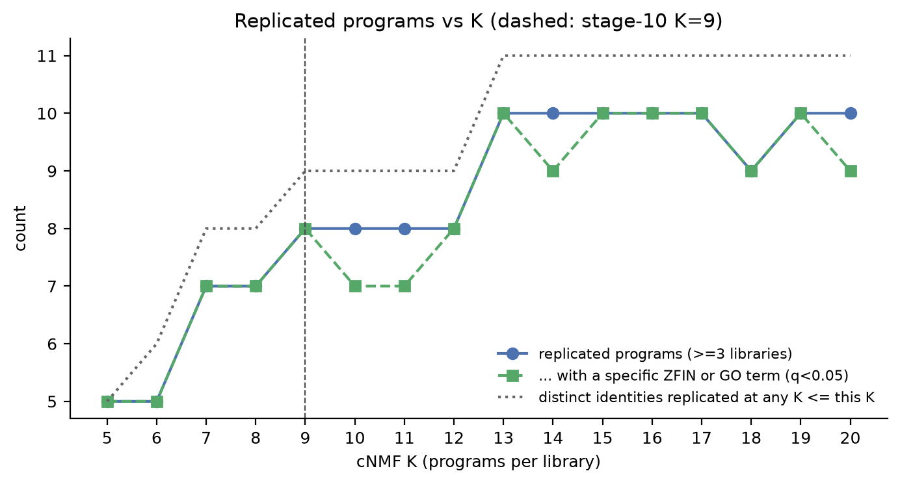
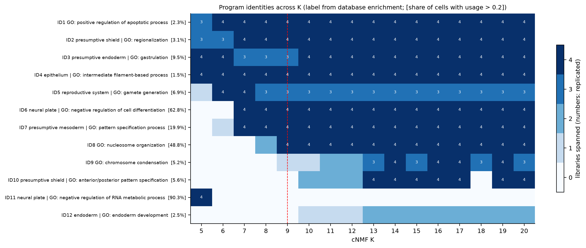

# How many replicated programs? cNMF K scan from 5 to 20

Generated by `scripts/11_program_k_scan.py`. It reuses the stage-10
replication and annotation code unchanged (`scripts/program_tools.py`).

The number of replicated programs in [10_gene_programs.md](10_gene_programs.md)
(8 at K = 9) is not chosen directly; it follows from K. So instead of
defending one K, the whole stage-10 procedure is repeated at every K from 5
to 20 (the 16–20 extension uses its own seed, so 5–15 are unchanged). At
each K:
- programs are linked by mutual best match plus top-50 overlap (q < 0.001);
- a program counts as replicated if it is in at least 3 of 4 libraries;
- its signature is annotated by ZFIN in-situ and GO BP enrichment.

Programs from all Ks are then grouped into **identities** by spectra
correlation (average linkage, r ≥ 0.6). This shows which programs persist,
which appear, and when they first replicate.

## The replicated set saturates at 10

| K | 5–6 | 7–8 | 9–12 | 13–20 |
|---|---:|---:|---:|---:|
| meta-programs found (any library count) | 7–8 | 8–12 | 13–21 | 22–46 |
| **replicated (≥ 3 libraries)** | 5 | 7 | **8** | **10** (9 at K = 18) |
| distinct replicated identities, cumulative | 5–6 | 8 | 9 | **11** |

- From K = 13 to 20 the total number of programs more than doubles (22 → 46),
  but the number of replicated programs stays at 10, and no new replicated
  identity appears.
- Every extra component at high K is library-specific: a sub-split, noise,
  or something only one library resolves.
- The single cumulative identity beyond the 10 is the K = 5 merged ectoderm
  program (ID11), which splits into the MP5/MP6 pair from K = 7–9.

So **10 is the number of replicated programs this data supports**. K = 9
found 8 of them; K ≥ 13 adds two.

## The 10 replicated programs

Labels are the most specific ZFIN term (highest fold, ≥ 5 genes, q < 0.05)
and the best GO term (smallest p). Both come from the representative
meta-program, which is the stage-10 program wherever one exists.

| ID | Stage-10 MP | Label (ZFIN \| GO) | Replicated at K | Cells with usage > 0.2 |
|---|---|---|---|---|
| ID4 | MP1 | epithelium (EVL) \| intermediate filament-based process | all 16 | 1.5% |
| ID7 | MP2 | presumptive mesoderm \| pattern specification | 7–20 | 20% |
| ID2 | MP3 | presumptive shield \| regionalization | all 16 | 3.1% |
| ID3 | MP7 | presumptive endoderm \| gastrulation | all 16 | 9.5% |
| ID1 | MP4 | — \| positive regulation of apoptotic process | all 16 | 2.3% |
| ID6 | MP5 | neural plate \| negative regulation of cell differentiation | 7–20 | 63% |
| ID8 | MP6 | — \| nucleosome organisation | 9–20 | 49% |
| ID5 | MP8 | reproductive system (= PGC term set) \| gamete generation | **8–20** cleanly (6–7 merged, see below) | rare (3–5 cells/library) |
| **ID9** | (MP11, DS4 only at K = 9) | — \| **chromosome condensation** | 13–20 (3–4 libraries) | 5.2% |
| **ID10** | split from MP3 | **presumptive shield** (ACVR1BA, ADMP, GSC, NOG1, NOTO; q = 3e-8) \| A/P pattern specification | 13–17, 19–20 | 5.6% |

Notes:
- **ID5's label "reproductive system"** ties with *primordial germ cell*,
  *germ line cell* and *motile cell*: the same 7 of 9 genes (DND1, NANOS3,
  DDX4, TDRD7A, CA15B, H1M, RGS14A), all at 172×. The tie is broken
  alphabetically.
- **ID9 has no ZFIN term with ≥ 5 genes.** Its GO term rests on the
  replication-dependent histone genes in its signature, alongside MKI67 and
  CENPF.

## What changes relative to stage 10

1. **Proliferation is a replicated program (ID9).** At K = 9 it appeared only
   in DS4 (MP11) and was reported as library-specific. From K = 13 onward it
   is found in 3–4 libraries. It was a resolution effect, not a DS4 artefact.
   Its signature is histone-cluster genes plus MKI67 and CENPF, so it is
   cell-cycle (S/G2-M) signal. It is worth tracking as a technical/biological
   covariate rather than as a cell type.
2. **The dorsal margin splits in two from K = 13 (ID10).**
   - The new program (NOTO, ADMP, CHD, FOXD3, XBP1, FOXA3) is still
     ZFIN-enriched for *presumptive shield*.
   - The original MP3 identity (GSC, NOG1, FRZB, FZD8B, SIX3B) persists
     alongside it, with ZFIN *axial / anterior axial hypoblast* terms in
     stage 10.
   - This is the stage-07 "organizer" population finally replicating. It
     needed enough components to separate from the prechordal/anterior axial
     part, which explains why it never replicated as a cluster.
3. **PGCs (ID5) are a clean, replicated program from K = 8 to 20, always in
   the same three libraries** (DS3, DS4, DS4b). It is never resolved in DS2.
   - The identity table reports ID5 as replicated already at K = 6–7. Those
     members are broad programs (DS2_P1/P2, DS4_P1/P2, plus two DS3 programs
     at K = 6) that carry germ-plasm and early-blastula genes together. At
     low K the PGC signal is merged with the MP6-like early program, so
     K = 6–7 should not be counted.
   - That is also why stage 10's K = 7 check found min r = 0.34 (the DS4
     member's best K = 7 match is the broad DS4_P2).
   - Why DS2 lacks it is unclear. It isn't a lack of germ-plasm-positive
     cells (91 DS2 cells have ≥ 2 of NANOS3/DND1/DDX4/TDRD7A), so a cell-level
     PGC call would be needed to compare libraries.
   - This conflation is a general caveat: identity grouping at r ≥ 0.6 can
     join a specific program with a broad program that contains it. The
     per-K membership is in `tables/11_k_scan_programs.tsv`.

## Library-specific programs: what survives the scan

Of 38 identities in total, 26 never span more than one library at any K.
The ones worth knowing about:

| Program | Evidence | Verdict |
|---|---|---|
| **Forerunner-like** (DS4: FOXJ1A, SOX17, SOX32, SULT6B1, AQP3A; ZFIN *forerunner cell group* 5/52, q = 5e-5) | found in DS4 at **every** K from 5 to 20, never in another library | **Real cells, but not resolvable as a replicated program.** Co-detection of the signature genes shows candidate cells in every library (cells with ≥ 4 of 6 genes: DS3 16, DS4b 5, DS2 4, DS4 4). In the other libraries cNMF folds them into the endoderm program, which shares SOX17/SOX32. Treat as a candidate population. Confirming it would need a targeted cell-level classifier or a dataset with more of these cells. |
| **SOX32/SOX17/GATA5/6 sub-program** (ID12; DS3 + DS4b at K ≥ 13; ZFIN *endoderm*, q = 2e-10; GO *endoderm development*) | 2 libraries only | an endoderm sub-state resolved at high K in two libraries. Possibly the same forerunner/dorsal-endoderm cells, possibly early endoderm; not replicated |
| **EVL sub-programs** (stage-10 MP9, MP10, MP13) | cluster into the EVL identity (r ≥ 0.6); EVL never splits into two *replicated* programs at any K | EVL heterogeneity exists but is library-specific in form |
| proliferation (MP11) | becomes replicated at K ≥ 13 (ID9 above) | no longer library-specific |

## Recommendation

- **Use the 10 identities as the program catalogue**, with the K at which
  each is resolved (`tables/11_k_scan_identities.tsv`).
- **A single K = 13–15 run captures all 10 at once.** Worst-library
  stability is 0.78 at K = 13, similar to K = 9's 0.80, so that would be a
  reasonable choice if one factorisation has to be picked. K = 9 remains the
  better choice for the 8 shared programs alone, because the broad
  ectoderm/early programs are cleanest there.
- **Going beyond K = 20 is unlikely to help.** Replication has been flat
  since K = 13, while library-specific programs keep accumulating. The
  limits now are cell numbers (forerunner-like cells, PGCs) and the four
  libraries, not K.

## Outputs

| File | Contents |
|---|---|
| `tables/11_k_scan_summary.tsv` | counts per K |
| `tables/11_k_scan_programs.tsv` | every meta-program at every K: libraries, labels, q, top genes, identity |
| `tables/11_k_scan_identities.tsv` | identities with label, representative, libraries spanned at each K, first replicated K |
| `data/processed/09_programs/` (gitignored) | per-library consensus programs for every K; `results/tables/09_programs_*_k9_*` keeps the main-K copies |
