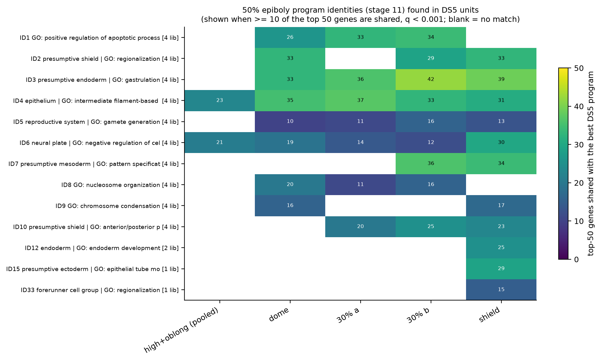
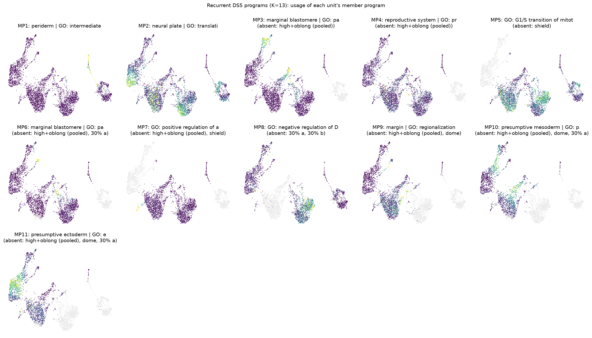

# Gene programs in the DS5 libraries, and how they relate to 50% epiboly

Generated by `scripts/12_ds5_programs.py`. It uses the same cNMF settings
(`scripts/cnmf_tools.py`) and the same matching and annotation code
(`scripts/program_tools.py`) as stages 09–11.

## Why this works across the batch boundary

Programs are found **within** one library at a time. They describe which
genes co-vary across that library's cells, not absolute expression levels.
Comparing gene loadings between a DS5 program and a 50% epiboly program is
therefore not affected by the DS5 vs DS2–DS4 batch offset that confounded
every joint embedding (stages 03–07).

## Setup

**Units.** NMF on 48–128 cells is not meaningful, so the four high/oblong
libraries are pooled into one unit (511 cells). Stage 07 showed they are
transcriptionally inseparable and co-embed completely. The other units are
single libraries:

| Unit | Cells |
|---|---:|
| high + oblong (4 libraries, pooled) | 511 |
| dome | 1,174 |
| 30% epiboly a | 448 |
| 30% epiboly b | 1,058 |
| shield | 1,046 |

**Factorisation.**
- cNMF per unit on raw counts, with no batch correction.
- K = 5–15, with the stage-09 rule (K ≥ 7 maximising the worst unit's
  stability). That gives **K = 13**.
- Stability is lower and flatter than at 50% epiboly: worst unit 0.68 vs
  0.80. The pooled high/oblong unit, which has little structure, is always
  the weakest (`tables/12_k_selection.tsv`).

**Recurrence within DS5.**
- Linking is as in stage 10: mutual best match plus top-50 overlap
  q < 0.001.
- The units are different stages, so a stage-specific program can occur in
  at most two of them (30% a/b). A DS5 program is therefore **recurrent** if
  it is found in ≥ 2 units.
- Annotation uses ZFIN in situ at **3.33–6.0 hpf** plus GO BP.

**Matching to 50% epiboly.**
- Every DS5 program is compared with all 800 50%-library programs (K = 5–20).
- A **match** needs ≥ 10 of the top 50 genes shared, with q < 0.001 (BH
  over all pairs).
- Each DS5 program is assigned to the stage-11 identity of its single best
  partner: largest overlap, then highest r.
- Pearson r is reported but not thresholded. Across batch and stage it is
  depressed by gene-wide noise; pairs with overlap q < 1e-20 have
  r = 0.3–0.9. A first version used r ≥ 0.5, and it rejected obviously
  correct matches such as DS5 PGC ↔ 50% PGC (16 shared genes, r = 0.48).

## 1. How many programs recur within DS5

| K | 5 | 7 | 9 | 11 | 13 | 14 | 15 |
|---|---:|---:|---:|---:|---:|---:|---:|
| programs in ≥ 2 units | 6 | 7 | 6 | 9 | **11** | 9 | 9 |
| programs in ≥ 3 units | 4 | 4 | 4 | 8 | 9 | 9 | 5 |

(Full table: `tables/12_ds5_recurrence_by_k.tsv`.) At K = 13 there are **11
recurrent DS5 programs**. **Every one of them matches a 50% epiboly
program:**

| DS5 MP | Units | Label (ZFIN \| GO; DS5 window) | Matched 50% identity (stage 11) | Top-50 shared |
|---|---|---|---|---:|
| MP1 | all 5 | periderm \| intermediate filament-based process | ID4 EVL | 37 |
| MP2 | all 5 | neural plate \| translation | ID6 presumptive ectoderm / neural plate | 30 |
| MP3 | dome, 30a, 30b, shield | marginal blastomere \| pattern specification | ID3 presumptive endoderm / mesendoderm | 42 |
| MP4 | dome, 30a, 30b, shield | reproductive system (germ line) \| primordial germ cell migration | ID5 primordial germ cells | 16 |
| MP5 | high/oblong, dome, 30a, 30b | — \| G1/S transition of mitotic cell cycle | ID8 early-declining (stage-10 MP6) | 20 |
| MP6 | dome, 30b, shield | marginal blastomere \| pattern specification (GSC, CHD, NOG1) | ID2 dorsal margin / axial hypoblast | 33 |
| MP7 | dome, 30a, 30b | — \| positive regulation of apoptotic process | ID1 p53 response | 34 |
| MP8 | high/oblong, dome, shield | — \| histone genes (*negative regulation of DNA recombination*) | ID9 proliferation | 17 |
| MP9 | 30a, 30b, shield | margin \| regionalization (CHD, NOTO, ADMP, FOXD3) | ID10 dorsal organizer | 25 |
| MP10 | 30b, shield | presumptive mesoderm \| pattern specification | ID7 ventrolateral margin / mesoderm | 36 |
| MP11 | 30b, shield | **presumptive ectoderm** (GATA2A, ID1, RGCC, SOX3, TFAP2A; 37×, q = 1e-6) \| epithelial tube formation | ID6, and best of all the single-library 50% program ID15 (29 shared) | 29 |

## 2. All 10 replicated 50% programs are found again in DS5

Read from the DS5 side, the rows of the figure give *when* each program is
present (each DS5 program counted once, toward its best partner's identity):

| 50% identity | high/oblong | dome | 30% a | 30% b | shield |
|---|:-:|:-:|:-:|:-:|:-:|
| ID4 EVL | ✓ | ✓ | ✓ | ✓ | ✓ |
| ID6 ectoderm / neural plate | ✓ | ✓ | ✓ | ✓ | ✓ |
| ID3 mesendoderm / endoderm | | ✓ | ✓ | ✓ | ✓ |
| ID5 PGCs | | ✓ | ✓ | ✓ | ✓ |
| ID8 early-declining | (DS5 program present, below match threshold) | ✓ | ✓ | ✓ | |
| ID1 p53 | | ✓ | ✓ | ✓ | |
| ID2 dorsal margin / axial hypoblast | | ✓ | | ✓ | ✓ |
| ID9 proliferation | | ✓ | | | ✓ |
| ID10 dorsal organizer | | | ✓ | ✓ | ✓ |
| ID7 ventrolateral mesoderm | | | | ✓ | ✓ |

Notes:
- **The order of appearance is developmental.** EVL and ectoderm are present
  from the first stages. The margin programs (mesendoderm, PGCs, dorsal
  margin) start at dome. The dorsal organizer appears from 30% epiboly, and
  ventrolateral mesoderm only from 30% b / shield.
  - This agrees with the signature-score projection in stage 10. Here it
    comes from programs *discovered independently* in each DS5 library, not
    from projecting 50% signatures.
- **The early-declining program (ID8 / stage-10 MP6) is DS5-native.**
  - DS5 finds its own version (MP5: CCNA1, CLDND, MKRN4, …; GO *G1/S
    transition*) from high/oblong to 30% b. It is absent at shield.
  - That matches the timing seen in the stage-10 projection.
  - The high/oblong member of MP5 is linked to the others within DS5, but it
    shares too few top genes with the 50% version (6 of 50, r = 0.10) to
    match directly. One reading is that at high/oblong the program is
    broader than what remains at 50% epiboly; the data alone don't settle
    this.
- **No PGC program is resolved in high/oblong.** That fits the stage-10
  observation that germ-plasm transcripts are spread across many early
  cells.

## 3. Three 50% single-library programs are found again in DS5

These were seen in only one or two 50% libraries, so stage 11 could not
call them replicated. Each is now found independently in a second batch and
stage:

| 50% program (stage 11) | Seen at 50% in | DS5 match | Evidence |
|---|---|---|---|
| **Forerunner-like** (ID33; DS4 at every K) | DS4 only | shield, own program (DS5_shield_P9; ~3 cells) | 18 of the top 50 genes shared with the DS4 program at K = 9, including **FOXJ1A (shield rank 1), SOX17 (14), SOX32 (39)**, VGLL4L, TMEM106BA, SULT6B1, AQP3A. ZFIN *forerunner cell group* reaches q = 5e-5 in DS4. In shield only 3 genes reach it (q = 0.008); the shield program's strongest ZFIN terms are EVL/periderm epithelial ones |
| **SOX32/SOX17/GATA5-6 endoderm sub-program** (ID12) | DS3, DS4b (K ≥ 13) | shield (DS5_shield_P6) | 25 shared genes, q = 4e-45. ZFIN *endoderm* 4/9 (ACKR3B, CXCR4A, FLRT3, GATA5), q = 3e-7 |
| **Second ectoderm program** (ID15; DS3 at K = 12) | DS3 only | 30% b + shield (DS5 MP11) | 29 shared genes. ZFIN *presumptive ectoderm* 5/19, q = 1e-6. Distinct from the broad neural-plate program (MP2/ID6). Its genes include GATA2A, TFAP2A, BMP7A, VOX, which *suggests* ventral/non-neural ectoderm, but no database term in the test distinguishes dorsal from ventral ectoderm, so that remains a hypothesis |

So **forerunner-like cells are now a two-library, two-batch observation**
(50% DS4 and shield). They are still only a handful of cells in each.

EVL sub-programs (50% stage-10 MP9/MP10/MP13) have DS5 counterparts too: EVL
splits into extra programs in dome, 30% a, 30% b and shield. These share more
genes with the main 50% EVL programs (10–16 of 50) than with the specific 50%
EVL sub-programs (3–13 of 50), except shield_P10 vs DS4b_P9 (13). EVL
heterogeneity is real in every library, but its sub-states do not reproduce
as consistent programs.

## 4. DS5-only programs

These DS5 programs have no 50% match:
- **High/oblong:** 8 single-unit programs. All small (1.5–6% of cells) and
  without specific database support, so they are most likely noise from
  factorising 511 low-structure cells at K = 13.
- **Dome MP20:** broad, 26% of cells (SI:CH1073-190K2.1, GPD1B, SNRPD3,
  HAPLN4…), no database annotation. These are the genes of the weak early
  split noted in stage 06 (dome clusters 1 vs 2, high 0 vs 1). It is a
  real, DS5-specific axis without a 50% counterpart and without a database
  identity.
- **Small single-unit programs** (30% a/b, shield) are mostly additional
  histone-gene variants, a second germ-plasm program in 30% b (MP31: NANOS3,
  TDRD7A, DND1, H1M) and unannotated programs with 1–2% of cells.

## Caveats

- **Units are stages.** Recurrence "in ≥ 2 units" mixes replication (30% a/b)
  with persistence across time. Only the 30% a/b pair is a true replicate
  comparison.
- **The pooled high/oblong unit combines 4 libraries.** It is justified by
  stage 07, but it is not an independent single-library sample like the
  others.
- **The match rule is permissive by design:** ≥ 10 of 50 shared genes. Each
  DS5 program is counted once, toward its best partner, to avoid crediting
  nested 50% sub-splits. All pairs that pass are in
  `tables/12_ds5_vs_50pct_matches.tsv`.
- **Forerunner-like and the endoderm sub-program rest on very few cells**
  (≈ 3–30 per library). They are candidates for a targeted cell-level
  analysis, not established populations.

## Outputs

| File | Contents |
|---|---|
| `tables/12_k_selection.tsv`, `12_ds5_recurrence_by_k.tsv` | K choice, recurrence counts per K |
| `tables/12_ds5_meta_programs.tsv` | DS5 meta-programs: units, labels, top genes, matched 50% identity |
| `tables/12_ds5_best_50pct_match.tsv` | best 50% partner for every DS5 program |
| `tables/12_ds5_vs_50pct_matches.tsv` | all DS5 × 50% pairs passing the match rule |
| `tables/12_ds5_vs_50pct_identity_by_unit.tsv` | identity × unit matrix (figure) |
| `tables/12_ds5_{zfin,go}_enrichment.tsv` | full enrichment tables (ZFIN window 3.33–6.0 hpf) |
| `tables/12_programs_<unit>_k13_*.tsv` | main-K programs; all K in `data/processed/12_programs/` |
