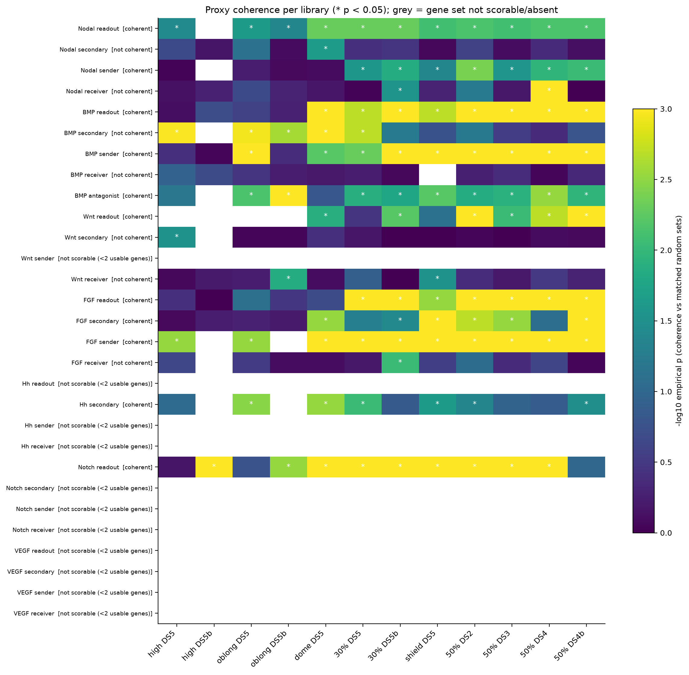
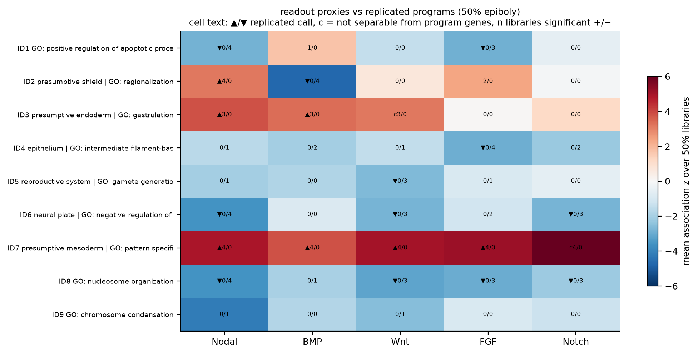
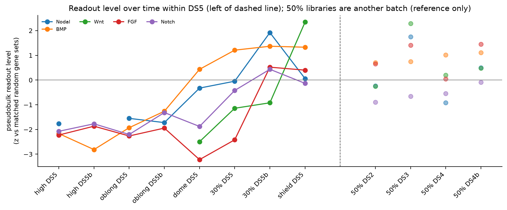

# Transcriptional proxies of signalling activity (stage 13)

Generated by `scripts/13_pathway_proxies.py`. Gene resolution is in
`scripts/pathway_tools.py`, and the input gene lists in
`scripts/pathway_proxies.tsv` are transcribed verbatim from the resource
supplied by the user. The resource is treated as **hypotheses**, and every
step is built so that a proxy can fail.

Throughout, "high" / "low" are **relative**: cells using a program carry
more (less) of the pathway's readout than other cells *of the same library*.
They are not absolute activity levels, and nothing is compared at the cell
level across batches.

## 0. Gene sets: resolved through ZFIN, fixed before scoring

- 121 resource entries were resolved via ZFIN gene, alias and full-name
  tables (`tables/13_gene_resolution.tsv`), giving 99 matrix genes.
- **Rule:** an alias is never used if it is today's current symbol of a
  *different* ZFIN gene. This rejected the alias matches `wnt3a → WNT3`,
  `fgf8a → ACE` and `lrp5 → LRP6`.
- **Resolved by ZFIN full name:** `lefty1 → lft1`, `lefty2 → lft2`,
  `sizzled → szl`.
- **Resolved by alias:** for example `vent → ventx`, `chd → chrd`,
  `sef → il17rd`, `boz → dharma`, `flh → noto`, `bmp3b → gdf10b`.
- **Unresolved, not substituted** (ZFIN symbols listed for your review, not
  used):

  | Resource symbol | ZFIN candidates | Note |
  |---|---|---|
  | cer1 | – | no ZFIN gene |
  | vox1, vox2 | vox | |
  | acvr1a | acvr1l … | |
  | lef1a | lef1 | |
  | pepd1 | pepd | |
  | dll3, dll4a | dll4 | |
  | etv3 | – | |
  | vegba | vegfab … | |
  | smoo | – | |
  | tqn1 | – | |
  | id-like | – | family placeholder |
- **wnt11f2 is excluded.** The matrix's `WNT11` is a 2015 name, but `wnt11`
  is now the current symbol of another gene. The symbol-only matrix can't
  disambiguate.
- **Detection filter:** a gene is used if detected in ≥ 1% of cells in ≥ 2 of
  the 12 libraries.
- **Tiers:** readout (primary proxy); secondary (lineage TFs, sensitivity
  only); sender and receiver (by GO molecular function: receptor ligand
  activity / signaling receptor activity); BMP antagonists.

| Pathway | Readout genes used | Other scorable tiers |
|---|---|---|
| Nodal | LFT1, LFT2 | secondary (EOMESA, FOXH1, GSC, MIXL1, SOX32); sender (GDF3, NDR1, NDR2); receiver (ACVR1BA, ACVR2AA) |
| BMP | SMAD6A, SMAD7, VED, VENT | secondary; sender (BMP2B/4/7A/7B, GDF6A); receiver; antagonist (CHD, GREM1A, NOG1, SZL) |
| Wnt | AXIN2, SP5A | secondary; receiver (FZD7A/B, LRP6) |
| FGF | DUSP6, IL17RD, SPRY1, SPRY2, SPRY4 | secondary; sender (FGF3/4/8A/24); receiver |
| Notch | HER1, HER7, HER11, HER12, HES6 | – |
| Hh | **not scorable** (GLI1 only; PTCH1 0%, PTCH2 0.2%) | secondary (FOXA2, GLI2A, NOTO) |
| VEGF | **not scorable** (ETV2 0.1%) | – |

The gene sets: `tables/13_gene_sets.tsv`.

## 1–2. Do the proxies behave like coherent signals?

**Null.**
- For every set, 1,000 random gene sets are drawn gene-by-gene from genes
  in the same expression bin (mean × detection), excluding all pathway
  genes.
- Coherence is the mean pairwise correlation of the set's genes after
  kNN-smoothing within the library, compared with the random sets.

**Calibration.** 50 random 4-gene "pseudo-pathways" were run through the
whole pipeline:

| Test | Random pseudo-pathways | Real readouts |
|---|---|---|
| coherence p < 0.05 per (set, library) | **6%** (nominal 5%) | 6–9 of 9 libraries |
| pass the "≥ half of libraries" rule | **1 / 50** | Nodal, BMP, Wnt, FGF, Notch |
| replicated high/low call vs a program | **1 / 500** | see below |

**Results by pathway:**
- **All five scorable readout sets are coherent:** Nodal 9/9 libraries
  (≥ 200 cells), BMP 8/9, FGF 7/9, Notch 7/9, Wnt 6/8.
- **Several other tiers are coherent too:** Nodal, BMP and FGF *senders*
  (ligands co-expressed at the margin), BMP antagonists, FGF secondary
  (ETV4/ETV5B/FOXG1A) and Hh secondary (FOXA2/GLI2A/NOTO, which are axial
  lineage TFs).
- **Receivers are coherent for no pathway.** Receptor expression is broad,
  so it isn't informative here.
- **Coherence has a time signal within DS5.** Nodal readouts cohere from
  high stage onward. BMP and Notch readouts cohere consistently from dome,
  and FGF from 30% epiboly. At high/oblong they are mostly not coherent:
  Notch reaches p < 0.05 only in the two smallest libraries. That is
  consistent with those signals not yet being organised.
- **Negative controls behave as expected:** Hh and VEGF readouts are
  undetectable (< 1% of cells), as the resource predicts for this window.

**ZFIN spatial agreement** (readout genes' in-situ anatomy terms at
3.33–6.0 hpf vs random annotated genes; `tables/13_proxy_zfin_agreement.tsv`):

| Pathway | Annotated readout genes | Result |
|---|---|---|
| Notch | 5 | supported (p = 0.004; shared *margin*, *presumptive mesoderm*) |
| Nodal | 2 (LFT1, LFT2) | borderline (p = 0.051; shared *margin*, *germ ring*, *marginal blastomere*) |
| FGF | 4 | not supported (p = 0.22; all 4 at *margin*, which is common) |
| BMP | 2 | not supported (p = 0.70) |
| Wnt | 1 | not testable |

Spatial support from ZFIN is therefore partial. It is limited by how few
readout genes have in-situ annotations in this window.

## 3–4. Which programs show which pathway?

Within each library, each readout score is correlated with each program's
usage. Significance comes from the same correlation computed with the 1,000
matched random sets, BH-corrected per tier.

A call is **replicated** if the same sign is significant in ≥ 3 of the 4 50%
epiboly libraries and the opposite sign in none.

**Circularity guard:** if a readout gene is among a program's top-50 genes,
the test is repeated without it. The call must replicate again, or it is
reported as "not separable from program genes".

**State table** (`tables/13_pathway_state_table.tsv`; K = 9 programs, K = 13
for ID9/ID10; the K = 13 calls are also given and agree except where noted):

| Program (identity) | Nodal | BMP | Wnt | FGF | Notch | Hh | VEGF |
|---|---|---|---|---|---|---|---|
| ID7 ventrolateral margin / presumptive mesoderm | **high**¹ | **high** (survives leave-out) | **high** | **high** (survives leave-out) | not separable² | ? | ? |
| ID3 presumptive endoderm / mesendoderm | **high** | **high** | not separable (SP5A) | – | – | ? | ? |
| ID2 dorsal margin / axial hypoblast | **high** | **low**³ | – | – (2/4 libraries +) | – | ? | ? |
| ID10 dorsal organizer (K = 13) | **high** | **low** | – | **high** | – | ? | ? |
| ID6 presumptive ectoderm / neural plate | **low** | – | **low** | – | **low** | ? | ? |
| ID8 early-declining program | **low** | – | **low**³ | **low** | **low**³ | ? | ? |
| ID4 EVL | – | – | – | **low** | – | ? | ? |
| ID1 p53 response | **low** | – | – | **low** | – | ? | ? |
| ID5 PGCs | – | – | **low** | – | – | ? | ? |
| ID9 proliferation (K = 13) | – | – | – | – | – | ? | ? |

"–" = no consistent difference. "?" = unknown, readout not detectable.

1. At K = 13, Nodal → ID7 becomes "not separable": LFT1 is among that
   program's top genes, and without it the call no longer replicates.
2. HER1, HER7 and HES6 are top genes of the ventrolateral-mesoderm program
   itself. Without them, association z drops from 6.4 to 0.7. RNA can't
   separate "Notch active" from "this is that cell type".
3. Low at K = 9; no consistent difference at K = 13. At K = 13 the dorsal
   margin is split into ID2 and ID10, and the low BMP signal goes with ID10.

**Reading the table:**
- **The margin programs carry the readouts.** Nodal is high across the
  dorsal margin, endoderm and organizer. BMP readouts form a dorsoventral
  split: high in ventrolateral mesoderm and endoderm, low in the dorsal
  margin and organizer. Wnt and FGF readouts are high ventrolaterally.
  These patterns come from data-validated proxies, not from the program
  labels.
- **The broad ectoderm and the early-declining program are relatively low**
  for Nodal, Wnt and Notch (and FGF for the early program).
- **Proliferation (ID9) shows no pathway association at all.** It acts as a
  useful internal negative control.
- **Replication in DS5:** for the 19 replicated 50% calls, the DS5 units
  carrying the same program give 29 significant concordant tests and 1
  discordant (Notch in high/oblong ectoderm), with the rest not significant
  (64 tests; leave-out applied where circular).
- **Secondary-tier (lineage TF) results** are in
  `figures/13_identity_pathway_secondary.png`. They are not used for calls
  because of circularity.
- **Sender/receiver results** are in
  `figures/13_identity_pathway_{sender,receiver}.png` and
  `tables/13_identity_pathway_50pct.tsv`.

## 5. Over time within DS5

The measure is the pseudobulk readout level per library, relative to the
matched random gene sets (`tables/13_time_course.tsv`). All DS5 libraries
are one batch, so this axis is developmental.
- **All five readouts rise** from high/oblong (z ≈ −2) to 30% epiboly /
  shield (z ≈ 0 to +2).
- **BMP rises first** (dome).
- **Nodal peaks at 30% b**, and **Wnt rises last and steeply** (shield).
- The 50% libraries are another batch and are shown for reference only.
- Caveat: a pseudobulk level mixes how many cells express a readout with
  how much they express. Library composition changes over time.

## 6. The BMP antagonist prediction failed, and why

The prediction was that, across programs, BMP-readout association would be
negatively correlated with association of the resource's secreted
antagonists. It isn't: the correlation is positive in 8 of 9 K = 9 / DS5
units (`tables/13_bmp_antagonist_test.tsv`). Testing each antagonist gene
on its own shows why (`tables/13_bmp_antagonist_gene_association.tsv`):

| 50% mean z | CHD | NOG1 | SZL | GREM1A |
|---|---:|---:|---:|---:|
| ID2 dorsal margin | **+6.4** | **+3.3** | **−4.9** | 0.1 |
| ID3 endoderm | −0.7 | 0.0 | **+2.3** | −0.1 |
| ID7 ventrolateral | 1.1 | 0.5 | 1.1 | 0.1 |

CHD and NOG1 are dorsal, where the BMP readout is low, which fits the
prediction. SZL does the opposite and tracks the BMP readout, so averaging
it with CHD/NOG1 cancels the signal. This is a post-hoc observation, not a
pre-registered test. The data suggest treating SZL as a BMP-responsive gene
rather than grouping it with the dorsal antagonists; a re-run with the
antagonist set split that way would be a new, explicitly labelled
hypothesis.

## Limitations

- **RNA readouts lag signalling and miss maternal protein.** The resource
  notes this for BMP and Wnt. "Unknown" is the honest call for Hh and VEGF
  here.
- **Autoregulation and lineage overlap.** Readout genes can be part of the
  identity of the very cells that respond: HER genes in ventrolateral
  mesoderm, LFT1 at K = 13, SP5A in endoderm. The leave-out test catches
  this, but it cannot recover activity once it is inseparable from identity.
- **Two-gene sets (Nodal, Wnt) are fragile.** Their coherence is strong, but
  ZFIN support is borderline (Nodal) or untestable (Wnt).
- **Notch oscillates.** Calls are program-level averages only. No per-cell
  states are inferred.
- **Dissociation removes position.** Sender, receiver and readout
  co-occurrence is not evidence of who signals to whom.

## Outputs

| File | Contents |
|---|---|
| `tables/13_gene_resolution.tsv` | every resource entry → status, ZFIN gene, matrix gene, GO role, detection, used |
| `tables/13_gene_sets.tsv` | final sets per pathway × tier |
| `tables/13_proxy_coherence.tsv`, `13_proxy_decision.tsv`, `13_proxy_zfin_agreement.tsv` | validation |
| `tables/13_calibration_coherence.tsv`, `13_calibration_calls.tsv` | false-positive calibration |
| `tables/13_program_association.tsv` | every set × unit × program test, incl. leave-out |
| `tables/13_identity_pathway_50pct.tsv` | replicated calls (K = 9 and K = 13) |
| `tables/13_pathway_state_table.tsv` | program × pathway state for the Boolean model |
| `tables/13_time_course.tsv` | DS5 (and 50%) readout levels |
| `tables/13_bmp_antagonist_test.tsv`, `13_bmp_antagonist_gene_association.tsv` | antagonist test |
